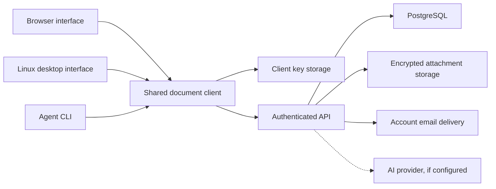

# WikiStow implementation spec

This project gives family and friends one place for personal knowledge and shared documents. People edit Markdown through a visual editor or source view. Their existing agents use a CLI, and a chat assistant in the app finds, drafts and organizes pages with them. Private and shared content is end-to-end encrypted, and publication controls which version readers see.

Status: implementation proposal based on the completed product interview. The product requirements below are agreed. Technical choices and explicitly marked defaults are proposed decisions to validate during implementation. This document does not claim that the encryption protocol or application has been built or audited.

Project name: WikiStow. CLI command: `wikistow`. Updated: 2026-10-21.

Related documents: [domain glossary](wikistow/CONTEXT.md), [interface design](wikistow/ui-design.md), and [implementation research](../Research/wikistow-implementation.md).

## Agreed first version

- One installation for family and friends. Registration starts closed to uninvited users, and an administrator can enable it.
- Accounts support verified email, password login, password reset, and optional authenticator-app two-factor authentication.
- Administrators invite people by email or single-use link, manage accounts, suspend access, and revoke sessions and agent credentials. Invitations expire after seven days.
- Spaces contain folders and pages. People can receive access to an entire space or a folder, never a single page. A grant covers the folder's existing and future descendants. Groups, named sets of people a space or folder is shared with as one, come in Milestone 5: built for people, with agents in groups not built yet.
- Personal and shared spaces use the same content model. Shared content requires authentication and authorization. The one exception is a page someone gives a public link: anyone with the link can read its published version, with no account ([ADR 0005](docs/adr/0005-public-links.md)). Search-indexed publishing is outside this version.
- Markdown is the canonical page source. People can switch between visual editing and source editing. The application supplies the theme.
- Drafts autosave. Readers see published versions; editors see drafts. Publishing is a separate permission. Published history records the person or agent responsible and supports restoration. An editor who can publish can tick a page's tasks, and change values its plugin blocks set, while reading it; each burst of those publishes one version, which history labels with what changed ("Ticked 3, unticked 1"), folding a run of them by one person into one row ([ADR 0008](docs/adr/0008-reader-change-labels.md)).
- A page can publish selected versions into another space without exposing its private working draft.
- Pages and folders can be moved or copied into another space. They bring their current draft and published version, sealed again for the destination; earlier history stays behind ([ADR 0007](docs/adr/0007-move-and-copy-between-spaces.md)).
- Existing agents use a CLI with their own identity and limited grants. Publishing is an additional grant, not implied by editing permission.
- Browser and Linux desktop clients come first. Search runs on the client over content the user can decrypt.
- Account login and vault unlocking are separate. A distinct vault passphrase protects encryption keys, and a recovery key provides a backup way to unlock them.
- No bulk importer. A person moves an Obsidian note by pasting its Markdown into a page, or has an agent push it through the CLI. A selected Obsidian note is the test case for both routes.

Offline editing, Windows and macOS packaging, comments, simultaneous live editing, semantic search, passkeys and MCP integration are later work. A stale edit produces a conflict instead of overwriting another writer.

## Architecture

Use a TypeScript pnpm workspace with four applications: a Vite-built React web app, a Linux Electron client, a Hono API server on Node, and a CLI released as one binary per system. A shared client library owns encrypted document operations. One shared React interface, built by Vite, runs in both the browser and the desktop renderer. The server owns identity, authorization, opaque structure, and encrypted storage, and also serves the built web app.

This departs from the preferred stack's Next.js on purpose (decided 2026-10-02). The server never reads stored content, apart from a public link's copy, so every page in the app is decrypted and rendered in the client. Next.js's server rendering, server components, and caching would go unused. Electron cannot run Next.js, so the web and desktop builds would also diverge. A static single-page app gives both clients one build. A plain JSON API keeps the server small and easy to audit. A static app can also enforce a strict Content Security Policy without per-request nonces. The cost: no server-rendered login or settings pages, and the API server, static serving, and development proxy are assembled by hand. Revisit if search-indexed publishing is ever added. Public links ([ADR 0005](docs/adr/0005-public-links.md)) don't change this: the server renders a public page itself, outside the app, as plain HTML with no app script, a strict policy of its own and `noindex`, so the app stays a static single-page app.



The diagram shows code responsibilities, not a single shared process. Each client runs its own document library. The CLI works while the desktop app is closed. Neither a background agent service nor a local HTTP server is required for the initial CLI.

| Area | Proposed choice | Reason and limit |
| --- | --- | --- |
| Web | Vite, React 19, TypeScript, TanStack Router | A static single-page app. Decryption and rendering happen only on the client. File-based routes, with the same route tree in the browser and desktop. |
| Interface | Tailwind 4, Radix/shadcn patterns | One accessible interface shared with desktop. Use an established component set before custom presentation work. |
| Data and forms | TanStack Query, React Hook Form, Zod | Separate server records from decrypted client state. Add Zustand only for state that needs it. |
| Server | Hono on Node (`@hono/node-server`), PostgreSQL, Drizzle | One JSON API for all clients. Validate requests with the Zod schemas in `packages/contracts`. Transactions protect revisions, invitations, and permission changes. The same process serves the built web app. |
| Authentication | Better Auth, mounted in Hono at `/api/auth/*` | Owns password authentication, verification, sessions, and TOTP. Application invitations, agent grants, and E2EE remain application responsibilities. |
| Desktop | Electron with a Vite-built renderer | Reuses the web app's interface and build, with native credential storage. The desktop package runs no local server. |
| Editor | CodeMirror 6 for source, Milkdown (`@milkdown/kit`, not Crepe) for visual editing | Markdown-oriented editing. A fidelity check keeps a page in source mode unless the visual editor reads it back the same. Each loads only when it's first used. |
| Cryptography | `libsodium-wrappers-sumo` candidate behind one encryption module | The sumo build supplies password-derived key functions. Await library initialization in browser and Node. Library primitives do not validate the application's sharing protocol. |
| Attachments | Private filesystem volume behind an authenticated blob interface | Enough for one installation. Add object storage if deployment requirements justify it. |
| Tooling | Vite+ (`vp dev`, `vp build`, `vp check`, `vp test`), Oxlint, Oxfmt, Vitest, browser tests | Vite drives development and builds for the web app and desktop renderer, so the whole Vite+ toolchain applies. *Proposed:* compile the server and CLI with tsdown. |

Suggested workspace responsibilities:

```text
apps/server       Hono API, Better Auth, email, and static serving of the built web app
apps/web          Browser entry: Vite build, router setup, browser key-storage adapter
apps/desktop      Electron main process, narrow preload, Vite-built renderer
apps/cli          Human and agent command interface
packages/client   Encryption, revision operations, sharing, and export
packages/ui       Editor, page views, navigation, routes, and shared application screens
packages/contracts Request and response schemas, IDs, and error definitions
packages/server   Authorization and transactional storage used only by apps/server
```

Keep framework, filesystem, and operating-system key storage outside the shared document operations. Do not export database types or server secrets into client packages. Clients get request and response types from `packages/contracts`, not from Hono's RPC type inference, because inference would make client builds depend on server code.

Request flow and deployment:

- **Same origin.** The web app and API share one origin. The server serves `/api/*` routes, with Better Auth at `/api/auth/*`, and static assets. Any other path returns `index.html`, so client-side routes load directly. Browser session cookies need no cross-origin requests. A connection that sends and takes nothing for 60 seconds is closed, such as a client that stopped reading a large file.
- **Development.** The Vite dev server proxies `/api` to the Hono server, which runs in watch mode, so development matches production's single origin.
- **One container.** A single Node image serves the API and the built app, with an attachments volume and PostgreSQL alongside. The CI pipeline changes only its build commands. Use a single authorized operation for each action so browser, desktop, and CLI cannot implement different permission rules.

## Content and permissions

Every page and folder has a stable ID and one parent within one space. A move between spaces is a copy, so the moved pages and folders get new IDs. A page path is a human-friendly client view derived from decrypted names. Renaming a page does not change its identity or break internal links.

Personal spaces start with one owner. Shared spaces have at least one owner and may have multiple owners. Space owners can access all content in their space, including drafts. Installation administrators have no implicit space ownership or decryption access.

Proposed default: the common library is an ordinary shared space with owner-managed membership. Creating an account does not automatically grant access to it or any private space. If the common library later admits every verified account automatically, its owners must explicitly opt into that audience and clients must still distribute keys to new members.

| Capability | Reader | Editor | Editor with publish | Space owner |
| --- | --- | --- | --- | --- |
| Read published content and published history | Yes | Yes | Yes | Yes |
| Read and save drafts | No | Yes | Yes | Yes |
| Create pages within an authorized container | No | Yes | Yes | Yes |
| Publish or unpublish | No | No | Yes | Yes |
| Manage sharing and ownership | No | No | No | Yes |
| Give a page a public link, or turn it off | No | No | Yes | Yes |
| Move or delete content across permission boundaries | No | No | No | Yes |
| Copy content they can edit to a folder where they can make pages | No | Yes | Yes | Yes |

Groups come in [Milestone 5](#milestone-5-groups): built for people, with agents in groups not built yet. A group belongs to a space and only its owners manage it. This avoids installation administrators gaining content access indirectly by adding themselves to a group.

Access comes from a share of a space or folder, and covers everything beneath it. Shares don't nest: a folder inside a shared folder can't be shared on its own, and a folder that contains a shared folder can't be shared. A person has one role in each share; with groups it is the highest their direct grant and their groups give (Milestone 5). There are no deny exceptions, so a private child cannot live beneath a shared folder.

Sharing a folder does not reveal its ancestors. The recipient sees it under Shared with me with a path starting at the shared folder. A reader cannot list an unpublished page's title or draft metadata.

An agent's effective permissions are the intersection of its own grants and its owner's current permissions. Agents cannot administer accounts, create invitations, alter sharing, or manage ownership in the first version. Space owners authorize shares; users authorize their agents within the access they already hold.

Moving a subtree previews the resulting audience change and requires space ownership. The move updates the tree and re-wraps the moved content's keys for its new share as one logical operation. A move into another space can't keep its records, which are bound to their space, so it is a copy that deletes its source: each page's current draft and published version, and each folder's name and look, are sealed again for the destination by the person moving them, and earlier history goes with the source. Only an owner of the source space moves content into another space. Copying does the same without the delete, into another space or the same one, for anyone who can read the content's drafts and make pages at the destination. A moved or copied page is a new page with a new address, and it brings no public link, publications, shares or agent picks. The preview shows the destination's audience, who loses access, pages that will arrive unpublished, links that won't work afterwards, and what a move ends ([ADR 0007](docs/adr/0007-move-and-copy-between-spaces.md)).

## Accounts and invitations

The administrator dashboard lists accounts, email-verification state, role, suspension state, and pending invitations. It supports resending invitations, copying a new link for one without mailing it, granting or removing administrator status, suspending or reactivating accounts, and revoking sessions and agent credentials. Both a resend and a new link stop the invitation's old link working. Its settings cover public registration, outgoing mail and the [AI provider](#ai-assistant). A variable in the server's environment wins over the setting it covers, which the dashboard then shows read-only. Saved secrets, the SMTP password and the AI key, are write-only and encrypted at rest with a key derived from the server's auth secret. Mail is optional at start; until it is set up, everything that would send mail says so, and since accounts after the first confirm their address by mail, nobody else can join. It must not expose decrypted document content or encryption secrets.

The public-registration setting controls uninvited account creation. When disabled, hide the public registration page and reject uninvited requests on the server. Invitation registration remains available. Apply the same rule to every enabled account-creation route, rather than protecting only the user interface.

Invitation tokens are random, single-use, stored as hashes, and expire after seven days. Email invitations bind to the normalized invited address. A generic invitation binds to the account created with it. If the address given already has an account, it creates nothing and binds nobody. Both require email verification before normal application access. Open registration and generic invitations take only the address: the mailbox owner chooses the name and password from the emailed link, which also verifies the address. Atomically reserve or consume the invitation with account creation; concurrent requests must not produce two accounts from one invitation. A refused request must not burn the invitation, but a generic invitation redeemed with an address that already has an account is used up like any other, so its status never shows whether an address is registered; only that address's owner is told. A created account awaiting verification can receive another verification email without reusing the invitation.

An account invitation does not contain vault keys or grant space access. After a person verifies their email and initializes their vault, a space owner can share content with that account. This avoids putting content secrets in email links. Sharing dialogs list everyone on the server with a vault, by name and email, to pick from, and the accounts that have confirmed their email but have no vault yet, which can't be picked. Everyone with a vault sees them; that's a deliberate choice for servers where people know each other (protocol section 7.3).

People change their own email in Settings. It needs a recent sign-in, with the second factor when it's on. A single-use link, valid for 24 hours, goes to the new address, and only opening it changes the account's address, which stays verified. The old address then gets a notice. Until then the old address keeps working, and asking again replaces the earlier link. The request gets the same answer whether or not another account has the address; if one has it when the link is opened, nothing changes. Keys are pinned by identity, so other people's contacts and shares keep working. Their contact labels keep the old email, and a lookup of the old address that finds another key is a key change (protocol section 8.4).

Names are unique on a server, case ignored. They are stored trimmed, with each run of whitespace inside them as one space. Every way to set one (an email invitation, the emailed setup link, first-run setup, and Settings) refuses a name another account uses with "Someone on this server already uses that name.", and a unique index keeps two requests at once from both winning. That tells people a name exists, which is fine where people know each other, and says nothing about emails. People change their own name in Settings, without a recent sign-in, since a name isn't a credential. Someone who already has the person as a contact keeps the name in their contact label, so a new name reaches the person's account menu, the admin dashboard and people who meet them later.

Configure password reset to revoke existing account sessions. Application-managed agent credentials require their own revocation path. Administrative suspension blocks all API and blob access, invalidates active sessions and agent credentials, and closes active subscriptions. Check account state on every authenticated request rather than relying solely on the lifetime of a session token.

An administrator reset cannot unlock a vault. TOTP recovery codes recover the second authentication factor; the vault recovery key recovers encrypted content. Name and explain these separately.

The first account on a new installation becomes its administrator. While the server has no accounts, the app offers to create it. Its address counts as verified, so setup works before mail is configured. Every later account verifies its email. Until the first account exists, anyone who can reach the server can claim it, the usual self-hosted first-run trade, so operators create it before sharing the address. Once any account exists the setup route refuses, so it never makes a second administrator. Prevent removal or suspension of the last active administrator. Administrative changes require recent authentication and TOTP when enabled. Do not offer account impersonation or direct password replacement in the dashboard.

Proposed deletion policy: account deletion removes the account's credentials, personal spaces, private blobs, and grants. Shared contributions remain under a non-login author record. Transfer sole-owned shared spaces or explicitly delete them before completing deletion. Warn about the concrete affected content and distinguish deletion from suspension. Backups expire under the deployment's documented retention policy; deletion cannot erase recipients' exported copies.

## Encryption and recovery

### What the service can see

Encrypt page titles, Markdown, attachment names and contents, and human-readable folder and space names. The server retains account emails, opaque resource IDs, parent relationships, memberships, permissions, revision identifiers, sizes, timestamps, and activity attribution. This version protects content, not all metadata or traffic patterns.

The server stores ciphertext and wrapped keys, not content keys, vault passphrases, recovery secrets, plaintext search indexes, or decrypted page previews. Keep plaintext out of request logs, error reporting, analytics, server caches, and background jobs. Public links, below, are the exception to storing plaintext: the server stores, renders and serves their copies, and still keeps them out of logs and error reports. Source-to-publication relationships are additional visible metadata; human-readable source names remain encrypted.

The [AI assistant](#ai-assistant) is an exception, by the person's choice: what they send to it passes through the server, decrypted, on its way to the configured provider. The server forwards it without storing or logging it.

A public link is the other exception, and the only page content the server stores readable ([ADR 0005](docs/adr/0005-public-links.md)). A person who can publish a page, not an agent, can give it a link that anyone can open with no account. The app then uploads a readable copy of the page's published version: its title, its Markdown without the frontmatter but with the property values its body shows written in as text ([ADR 0006](docs/adr/0006-page-properties.md)), other pages' values from their published versions only, never a draft, even one the person publishing can edit, and only from pages everyone who can read the page can open, the attachments the body shows or links to, and which of its wikilinks name, by their published titles alone, pages that have a link already. A link that names a folder, or a page without a link, stays text, and a link to another public page goes back to text when that page's link ends, until the linking page is updated. It uploads only after saying so on screen, never in the background. The public link dialog says before the first link that anyone with the link can read the page and that the server keeps a readable copy. On a page with a link, **Publish** asks first, and says publishing updates the public page too. When the body shows values from other pages, both say so: anyone with the link can read them, as they were when the copy was made, until the page is published again.

The server keeps that copy, and its own rendering of it, only while the link is on, and only of the current published version. Publishing a new version deletes the copy. A publish from the app uploads the new one; after a publish by an agent or from another space, the public page says it's being updated until someone updates it from the public link dialog. Turning the link off deletes the copy at once. So do unpublishing the page, deleting it or its space, and the person who shared it losing the right to publish it, by a move or otherwise. If the person who uploaded the current copy loses that right, the copy goes. The link stays on, and the public page says it's being updated until someone updates it. The app never uploads a draft or an older published version, unless a dishonest server names an older version as the published one ([protocol A12](wikistow/protocol.md#24-accepted-risks)). The server can't check the text against the encrypted version, so someone with publish rights calling the API directly could upload other text, as they could publish it. Older published versions are never kept readable, and neither is a page without a link: the app turns the link on before it uploads the first copy. An upload the app never finishes is deleted within 20 minutes of its last request for it. `backup.sh` leaves the copies out of its backups.

Turning a link off can't take back copies someone already saved, copies in other backups of the server made while it was on, or deleted rows that Postgres hasn't yet overwritten.

E2EE here protects against disclosure of stored server data. A malicious operator serving changed browser JavaScript could steal keys when someone unlocks the web app. The bundled desktop and CLI reduce dependence on live web code, but their updates also require trust. Do not promise protection against a compromised client or a model provider receiving content that a user deliberately sends to an agent.

### Human and agent keys

On vault creation, generate an account encryption key pair and signing key pair on the client. Protect the private keyring with a random vault wrapping key. Create separate encrypted wrappers for that wrapping key using the vault passphrase and the recovery key. The passphrase wrapper uses Argon2id with a random salt and versioned parameters calibrated on supported clients. Run derivation away from the interface thread and report memory failures rather than silently weakening the parameters. A high-entropy recovery key uses a suitable key derivation function and a separate context.

The account password and vault passphrase must be distinct. Password authentication necessarily gives the server access to the submitted account password. A password reset changes authentication, not vault encryption. A vault passphrase change only replaces its wrapper; it does not require encrypting all documents again.

Keep the keyring unlocked in memory for the current session. Remembering it on a trusted desktop requires a supported operating-system secret store. A browser tab keeps its unlock through a refresh: it holds the vault key in sessionStorage, encrypted with a non-extractable AES-GCM key kept in IndexedDB, so the passphrase is never stored, neither store holds a usable key on its own, and no page script can read the wrapping key out. The browser does keep both in its profile on disk until a lock or sign-out, so reopening a closed tab, or a browser restoring its tabs at restart, may bring the unlock back, as it does the sign-in. A new tab asks for the passphrase, though a duplicated tab carries the copy with it. Locking or signing out, in any tab, forgets the wrapping key and so every tab's copy, and the next load asks again; a tab that finds a copy kept for another account drops it. A remembered browser login is not a remembered vault unlock. A browser remembers the unlock for later visits only when asked to, which is off by default: **Remember on this browser** on the unlock page, or Settings → **Remember unlock**. It keeps one more copy, sealed under the same wrapping key, in `localStorage` (`wikistow.vault`), with the vault's version, so a new tab or a later visit opens the vault while the browser stays signed in. Anyone who can use that browser profile can then read the vault. Locking or signing out forgets it with the rest, in every tab, and so does a passphrase change made anywhere: the vault's version moves on, and a copy remembered at an older one is dropped unopened. Never persist an unsealed vault key in `localStorage`.

Locking when idle is optional and off by default. Settings → **Lock when idle** picks Off, 5, 15 or 30 minutes, or an hour, kept on the device in `localStorage` (`vault/idle-lock.ts`), in the browser and the desktop app alike. Once that long passes with nobody using the app, in any of the device's tabs or windows (keys, pointer, touch, scrolling; a hidden tab or minimized window has none), the vault locks as **Lock vault** does, dropping the kept unlock too. Background timers are slowed or paused, so it measures wall time, looking when a timer fires, when the page shows again, and at the first activity after, so a computer waking from sleep locks rather than starting over. A browser tab reloaded or restored, or a later visit, after that long without use asks for the passphrase rather than opening the vault it kept or the browser remembers, and forgets both. With nobody there to answer, a draft's typing is saved first; if that fails, or a file is still uploading, the vault stays open and tries again after the same delay.

Each agent generates its own encryption and signing keys. A person enrolls that identity from an unlocked client and grants selected content access. The CLI never receives the human's whole vault keyring or account password. Server credentials authenticate the agent; its separate keys decrypt the resources granted to it.

Revoking a session stops server access but cannot erase keys from a device. Suspected private-key compromise requires identity-key rotation and replacing grants for future content. Recovery-key rotation creates a new wrapper and invalidates the old server copy, but an attacker holding an older wrapper and recovery key may still unlock the old keyring. Distinguish wrapper replacement from rotation after compromise.

### Content keys and sharing

Proposed first-version strategy: generate a fresh content key for every immutable revision and fresh keys for its attachment payloads. Encrypt content with authenticated encryption. Each shared space or folder has folder keys: a draft key and a published key, with a new key version whenever someone is removed. Wrap each revision's content key with its folder's draft or published key, and seal the folder keys to each member's public key. Content outside any share stays sealed to the space's owners.

Adding a member then seals a few folder keys rather than every revision. Sharing a folder for the first time wraps each retained revision once. Benchmark realistic history and attachment sizes, including a first share of a large folder.

Draft recipients are editors, publishers, owners, and authorized editing agents. Published recipients also include readers. Publishing creates separately encrypted content and attachment payloads for the published audience. A reader must never receive a draft content key or a reusable key that can decrypt future drafts. Avoid cross-audience attachment deduplication in the first version.

Proposed primitives are XChaCha20-Poly1305 for payloads, sealed boxes for recipient key envelopes, and Ed25519 for signatures. Sealed boxes do not authenticate their sender. Authenticated encryption binds a payload to its installation, space, page, revision, audience class such as draft or published, and format version. Signed revision records bind the ciphertext hash and those identifiers to the writer. Recipient grants are separately authenticated so adding a recipient does not require changing an immutable revision's signature. The current permission state still controls which grants can activate. A signature proves authorship only after the recipient has authenticated the writer's public key; it is not a substitute for server authorization.

Folder and space names use their own encrypted metadata records and recipient envelopes. Page titles exist only within draft or published payloads, so a draft rename does not leak through a shared navigation record. Members of a shared folder receive no keys for its ancestors' names.

Before releasing a protocol, define and review the envelope format, nonce generation, canonical signing bytes, supported algorithms, identity enrollment, recipient-key verification, rotation, and version upgrades. Do not assume a changed public key returned by a directory is authentic. Pin the first key seen for each person, warn when it changes, and stop sharing with them until the user confirms the new key. The first key seen is trusted; that is an accepted risk. Agent enrollment compares a fingerprint shown by both the CLI and the person's app; for a chat assistant, which the app enrolls itself, the app checks the keys the server served are its own. A server signature alone does not protect against that same server substituting recipient keys.

Adding a member requires an owner's unlocked client to seal the folder keys to the new identity. The server cannot do this independently. A member is added together with their keys, so there is no pending state. Groups add one: a member a group brings in waits until an owner's app can seal to them (Milestone 5). New readers receive retained published history, while editors also receive retained drafts. This must be visible in the sharing dialog.

Removing access immediately blocks server retrieval through that grant. It doesn't change a public link someone else turned on that the person could see. Turning the link off and on again gives a new one, which they don't have unless a public page updated since links to it. The owner's client makes a new key version for the folder and seals it to the remaining people, and the server refuses saves under the old version. Commit writes against a permission version so a change prepared before revocation cannot silently include a removed recipient. Never claim to revoke plaintext or keys someone already obtained.

An administrator can suspend an account without keys. Suspension doesn't remove the account from shares; an owner does that. Reactivation restores login eligibility, not revoked agent credentials or revoked content grants.

### Recovery

Show the recovery key once during setup and require the user to confirm they saved it. Recovery combines authenticated account recovery with possession of that secret, then establishes a new vault passphrase. A valid unlocked device can also rewrap the vault key for a new passphrase.

If a person loses the passphrase, recovery key, and every unlocked authorized device, their personal encrypted content is unrecoverable. Owners of shared content can share their folders with a replacement identity, but cannot reconstruct unrelated personal keys.

## Drafts and publication

Each draft save creates a revision with an expected previous draft ID and permission version. The server commits the new head only if both still match. Otherwise it returns a conflict. The client preserves its unsaved text and presents the competing revisions. The CLI returns structured conflict details and a nonzero exit status. Do not silently merge or retry with a newer base.

Publishing names an exact draft revision. The publishing client decrypts it and prepares a fresh published payload for the published audience. A transaction checks the actor's publish permission, expected draft and published heads, permission version, and attachment availability before advancing the published head. Readers never briefly see an incomplete publication. Retry using an idempotency key cannot create duplicate versions.

Readers can inspect retained published versions. Editors can restore a published version into a new draft, except on a copy published from another page, which has no draft until it is detached. Restoration does not change the published head until someone publishes again. Restoring a publication makes it the draft; links to pages renamed since are written with their current published titles. Record both the draft author and the publishing actor, including the owning person when the actor is an agent.

Retention: published versions stay until their page or space is deleted. Draft checkpoints are implementation data. Every save adds one, and an hourly sweep removes those saved over more than `DRAFT_RETENTION_DAYS` ago (30 by default), so an open editor or a retried change still finds the draft it built on for that long. It keeps the current draft, every draft a published version was made from, and every draft a copy in another space was sent from; a page with copies sent before the server recorded their sources keeps all its drafts. No app reads the older drafts in between: history lists published versions, and saving, publishing, moving and restoring use only the current draft or a published version. So a kept draft may be based on one that is gone. A removed draft's keys and attachment references go with it, and attachment data nothing uses goes in the next attachment sweep. A save, move or share that names a removed draft is refused as stale, so the app reloads and tries again. An agent's activity is recorded as it writes, so it stays when its drafts go.

For publication into another space, maintain one destination page per source-and-destination publication. Copy and re-encrypt only the selected source version and chosen attachments under the destination permissions. Updating the source does not update the destination. The destination's published history contains only versions explicitly sent there. Deleting the source page ends its publications: each copy stays as it is, a page its publishers there detach to edit, and an opening that never got a version goes. A page made later with the deleted page's ID has no publications.

Proposed default: the destination is maintained from its source. Editing it independently requires an explicit detached copy. Source readers do not automatically gain destination access, and destination readers do not gain source access. Publishing requires publishing rights at the source page and at the destination, so a page's readers cannot copy it elsewhere. Keep source provenance encrypted and do not display inaccessible source paths.

Before publishing across spaces, show the destination audience, attachments, and links that recipients cannot open. Do not automatically publish linked private pages. Unpublishing removes the current reader-visible publication but cannot recall downloaded copies. It also turns off the page's public link, if it has one. The owner retains its history for restoration; do not leave an alternate history route exposing an unpublished page to readers.

## Editor and file portability

Start with CommonMark plus GitHub-style tables, task lists, and fenced code blocks. Support headings, lists, emphasis, links, images, and downloadable attachments. Render code without executing it. Sanitize rendered Markdown and disallow raw executable HTML. Remote images require an explicit loading policy so reading a private page does not silently contact third-party hosts.

As built, the reader reads a page's Markdown in a worker, off the page's thread, so the tab keeps answering, and turns the tree the worker gives back into HTML with the same filters as before: only safe link targets, only attachments as images. Raw HTML in a page renders, Markdown inside it too (a list in `<details>`), sanitized to GitHub's own list of tags and attributes, so no script, style, event handlers, forms or frames. As on GitHub, `<script>`, `<style>`, `<textarea>` and their like show as text. An image in it loads only if it's an attachment, at the width it gives, and a link goes through the same filter, as in Markdown. A heading's id comes from the text it shows, tags left out. A fenced `html` block stays code. A block quote whose first line is GitHub's alert marker alone, `[!NOTE]`, `[!TIP]`, `[!IMPORTANT]`, `[!WARNING]` or `[!CAUTION]` in any case, shows as that alert: the marker becomes a label with an icon, and the quote takes the alert's colours. Other Obsidian callouts, such as `> [!note] Title` or `> [!info]`, stay ordinary quotes, as written. Fenced code is highlighted by its language label, `bash` and `sh` among highlight.js's common languages, by lowlight in the worker, and in the visual editor as it's typed. A label it doesn't know, or code over 20,000 characters, stays plain code. Each code block shows its language at its top, as written, or `text` for none. In the reader a button at the end of that line copies the block's code as written, without the label, and shows a check for a moment once it has; a block a plugin draws has none. In the visual editor that label is a picker ("Code language", a menu in the palette's colours) of `text` and highlight.js's languages, with the block's own label too if it's none of them, so an unknown label is kept. Choosing a language changes only the block's label and highlighting, and `text` takes the label off. A block labelled `text` shows as `text`, keeping its label. Opening a block adds no label. Token colours come from the palette. Some text takes the parser far longer than its size suggests (#47), and nothing stops a parse once it has started, so a read that takes over ten seconds ends the worker, and the page is shown as written, with a note. A page nested past the parser's stack is shown as written too. The next read starts a worker afresh. What was read is kept a few minutes after the page is left, so going back to it shows it at once, and dropped with the other decrypted data when the vault locks.

The source editor is authoritative. Visual editing must preserve the supported Markdown semantics, though whitespace may normalize. If a page contains unsupported syntax, preserve the source and keep it in source mode with an explanation. Do not silently drop content when switching modes. Save editor-specific state separately from canonical Markdown.

As built, the draft view edits the body in the source editor, the visual editor or both side by side, chosen with a **Source**/**Split**/**Visual** switch. The last choice is remembered on the device in `localStorage`, as a preference, never page content. `localStorage` also holds the random key the visual editor marks its copies with (see Pasting), which holds nothing of any page. Either editor fills the space the page leaves it and scrolls within it, so a long page doesn't stretch the page around it. The source editor is CodeMirror 6. The visual editor is Milkdown with its CommonMark and GFM presets. It reads Markdown with the reader's own remark plugins, from the `markdownSyntaxes` registry, which also gives each syntax its visual-editor node.

In **Split**, the source editor is on the left and the visual editor on the right, or above it where the page card is under 800px wide, both editing the one draft. An edit in the visual editor reaches the source as the visual editor reports it. One in the source reaches the visual editor once typing pauses, for a quarter of a second or four times as long as the last one took to show there, whichever is longer, so a long page's checking and reading rarely hold up a key; or at once when the person turns to it, as the pointer comes over it or the focus does, checked first as any text given to the visual editor is; meanwhile the visual editor takes no edit. Neither side takes the focus or moves the other's cursor. Split opens only on a page the visual editor keeps whole, as Visual does. Text it wouldn't keep whole, such as a callout typed in the source or a note pasted into an empty page, holds the visual side, dimmed, with the reason ("The visual side is on hold…"), and typing goes on in the source until its text is one the visual editor would keep. An edit the visual editor can't write turns the page to source mode, as in Visual.

- **Fidelity check.** Before the visual editor opens a body, it reads it, writes it back as the editor would, line breaks included, and reads the result again. Both readings, by the reader's syntax and without positions or line-break style, must match. The reader's readings run in a worker, off the page's thread, so only the editor's own reading and writing hold up the page. A body the reader takes over 2 s to read there stays in source mode, as does one with a top-level block that takes over 250 ms with those beside it. Text given to an open visual editor is checked too, a paste or text the session puts in such as a renamed link; if it fails, the page turns to source mode with the note. Some syntax stays in source mode with a short note even when they do. Reference links and their definitions have no node, so the editor would write the links inline and drop the definitions. Obsidian syntax that Markdown reads as text would be escaped or edited as plain text: callouts, math, `%%` comments, and tags or highlights that start a line. GitHub's five alerts are the exception among callouts: the visual editor opens them, shows each with its label and colours as the reader does, keeps the marker as text, and writes it back unescaped. A quote typed with a marker alone on its first line becomes one too. Any other callout's note names its marker as written: a type with no alert, such as `[!INFO]`, says the visual editor only edits Note, Tip, Important, Warning and Caution callouts; one with more on the marker's line, such as `[!note] Title` or `[!note]-`, says the marker must be alone on its line. Raw HTML stays an inert atom, shown as written, which the reader renders; `<br>` is HTML too, not an empty paragraph.
- **No churn.** A visual document unchanged from what it opened with gives back the original bytes, so switching modes never changes the page. Milkdown only sees LF line breaks. An edited body is written again as Markdown, in the page's own line breaks (the frontmatter's, if the body has none yet) and final line break: `-` bullets, `*` emphasis, backtick fences, ATX headings and padded tables. Where `*` can't open or close, as right after a letter and before a link, remark picks `_` or writes the letter as a character reference. An empty paragraph writes nothing and an empty list item a bare `-`; an item whose emptied first paragraph has more after it writes that paragraph as `&#x20;`, so the rest stays in the item. Marks Markdown can't hold are left out: on spaces at a mark's ends, code on a link, image or HTML, and a link on a footnote reference. A link that a mark starts or ends inside is written once, with the mark inside it (`[**https://bank.example**.evil.example](…)`), never as two links; the mark is the one parted, outside the link and in it.
- **Write-time guard.** Each edit the visual editor writes is read back by its own reader, before the session gets it to save, and compared with the document on screen. Only what Markdown can't hold is set aside: whitespace at a line's ends or between words, empty paragraphs, list looseness, and marks on spaces alone. Links are counted in each block, so one link written as two, or two as one, differs too. If they differ, the page turns to source mode at once, with the note "The visual editor couldn't write your last change exactly, so this page is in source mode. Check the text below." The guard detects; it doesn't hold the text back. What the visual editor wrote has gone to the session to be saved, as every edit does, and the source editor shows that same text, the newest, keys typed meanwhile included, with the cursor where it was. So what's saved is always what's shown, and the next edit, in source mode, starts from it. Some documents have no Markdown at all, such as code in a table cell with a backslash just before a bar; the guard is what catches those. An unchanged document keeps its original bytes and isn't checked.
- **Writing a block at a time.** ProseMirror keeps each top-level block an edit leaves alone, so writing and checking go a block at a time, and an edit costs the blocks it changed, not the page. Blank lines part the blocks, so Markdown reads each as it reads it alone, except where one reaches into the next: HTML left open (`<!--`) takes what follows, a list beside a list joins it, and a footnote reference reads as one only if the page defines it. So new blocks are read with the blocks beside them, with stubs for the footnotes they name, and every footnote named must be defined; the last is read exactly as the page will end, with its final line break or without one, as the page had, since HTML left open there (`<pre>`) takes one in; lists next to each other are written together, as remark gives the second another bullet. An empty paragraph, which writes as nothing, goes with the block before it, so lists with one between them are written together too. A document that doesn't pass that way is read whole, which decides; normal editing, a paste included, never needs to. The work runs in idle time, in slices of about 10 ms, each ending before a step that wouldn't fit, and one after another while the browser stays idle, from when the editor opens; an edit is reported once its blocks are done, at most every 150 ms, and the last one at once as the editor closes or the page is hidden, however soon after the one before. A page just opened is written and read back a block at a time in that idle time. An edit made meanwhile is reported once the whole page is read back, never before, so every report is checked exactly as it's saved. One that must go out sooner, as the page is hidden, the editor closes or the person switches to source mode, has the rest written and read back then, in one task. A paste is checked by just its blocks and those beside them, read now, whether or not the rest have been. On a 100 KB page an edit typed while it's read back is reported about 2 s later, once it all is, one that must go out then takes about 1.7 s, and a paste about 50 ms; on a 200 KB page, about 4 s, 3 s and 80 ms. On a 100 KB page a key takes about 7 ms and is reported about 30 to 100 ms later, with tasks while typing of about 50 to 80 ms at most, ProseMirror's own cost on a page that size; writing and checking the whole page on each report would block for about 1.5 s. A seeded fuzz test applies random edits, addresses typed among them, to every corpus page, LF and CRLF, and holds each write to the whole check.
- **Formatting toolbar.** The visual editor has a toolbar above the text, for people who don't know Markdown or the shortcuts: a text style menu (text or heading 1 to 3), bold, italic, inline code, quote, code block, bulleted list, numbered list, link and attachment. Each control works on the selection or the block the cursor is in, shows as pressed while that has its format, and pressed again takes it off: bold off, the selected blocks out of a quote, a code block back to a paragraph a line, the selected items out of their list. A list of the other kind turns into this kind. The quote control is a split button: its menu offers an ordinary quote or one of GitHub's five alerts, Note, Tip, Important, Warning and Caution. In a quote, the button shows its kind's icon, the menu has its kind checked, and a choice turns that quote, the innermost, into the kind chosen, keeping what it holds: an alert's marker is changed, put first on a line of its own in its first paragraph (in a paragraph of its own before a heading, list or code block), or taken off with the line break after it. Elsewhere a choice quotes the selected blocks as that kind. Each quote also has its own type picker at its top ("Type of quote"), outside the editable text: Quote or one of the five alerts, its type checked, an alert's showing as the alert's label. A choice there turns only that quote into the kind chosen, the same way, and puts the cursor back in the text, at the end of that quote unless it was in it already, so undo takes it back and typing goes on there. Inline code at a bare cursor only takes the code the cursor is in off, since typed text wouldn't stay in it. A new code block has no language; one read with a language keeps it. Selected paragraphs go into one code block as its lines, line breaks included, without their marks; a wikilink or HTML goes in as its source, and an image is dropped, as undo can bring back. A control that doesn't apply where the selection is, such as bold in code, or a heading of text with a line break or a block of HTML, is shown but does nothing. So every change is one the write-time guard accepts. The link control opens a small form under it. On selected text it asks where the link goes and links the text; at the cursor it also asks for the link's text and inserts it, showing the destination as typed if the text is left empty; in a link it shows where the link goes, to change it or remove the link and keep its text. While the form is open the selected text, or the link the cursor is in, stays highlighted, and cancelling it (Cancel, Escape) changes nothing and puts the focus back in the text with the selection as it was. A bare domain gets `https://`, a `www.` address `http://` and an email address `mailto:`, as the reader would link them. It isn't offered on a selection with a wikilink, HTML or a footnote in it, which Markdown can't put in a link, nor at a cursor in inline code, which a link would split, and a link whose text is itself an address, such as a bare `https://…` or `www.…`, has no Remove link, as the reader links that text anyway. The links it makes are ordinary Markdown links, `[text](destination)`; wikilinks still come from typing `[[`. Links show underlined in the accent colour, as the reader shows them. The attachment control opens a menu of the page's attachments, those the Attachments panel lists (not the banner image), each with its name, kind (Image, or its file extension such as PDF) and size; a page with none says "No attachments yet". Choosing one puts it in at the cursor, in place of any selection, written as uploading it writes it: an image as ``, shown inline, and any other file as `[name](attachment:ID)`, which the reader shows as a download link. An attachment can go in as often as wanted, and nothing is uploaded again. The menu's last item, Upload a file…, uploads the files chosen as the Attachments panel does and puts them in at the cursor once they're uploaded, as pasted files go. The control is off in code, in a link, on a selection with any of a link in it, and on a selection across blocks, and closing the menu (Escape) changes nothing and puts the focus back in the text. Milkdown's shortcuts for these (Ctrl+B, Ctrl+I, Ctrl+E, Ctrl+Shift+B, Ctrl+Alt+C, Ctrl+Alt+7 and 8, Ctrl+Alt+0 to 6; Cmd for Ctrl on a Mac) do what the controls do, and the tooltips name them. The toolbar is one tab stop (`role="toolbar"`, roving tabindex): arrow keys, Home and End move along it, Escape or a command puts the focus back in the text, and Alt+F10 in the text moves to it. It stays above the text, which scrolls under it, and wraps on a narrow window. The source editor has none.
- **Several cursors.** The source editor edits several places at once, as VS Code does (#227). Ctrl+Alt+Up or Down adds a cursor on the line above or below, and on Linux, whose desktops often take those keys, Shift+Alt+Up or Down does too. Alt+drag selects a column, Ctrl+click adds a cursor where it lands, Ctrl+D selects the next match of the selection, and Escape goes back to one cursor; on a Mac, Cmd for Ctrl. Typing, line breaks and pastes go in at every cursor. Alt+Up or Down moves the line, and Shift+Alt+Up or Down copies it, Ctrl+Shift+Alt+Up or Down on Linux. The visual editor has one selection, as ProseMirror does.
- **Wrapping a selection.** In the source editor, typing `(`, `[`, `{`, `<`, `` ` ``, `"`, `'`, `*`, `_` or `~` over selected text puts it before the text and its pair after, at every selection, as one undo step (#227). The selection stays on the text inside, so typing again wraps once more: `*` twice makes `**bold**`, and `[` twice a `[[wikilink]]`. If any cursor has nothing selected, typing is as ever, and brackets never close themselves.
- **Wikilinks** are atoms holding their exact source. `[[` completion offers the same pages in both editors, never one the draft can't name. An ambiguous link has a button that opens the chooser, except in a link's text, where a button can't go; Alt+Enter opens it anywhere. A link typed out whole becomes an atom, but only when the typing wrote its brackets, so escaped brackets from the page stay text. Backspace after one opens it as text again. In a table cell a link's alias bar is held and written as `\|`, as a page holds it there, so it doesn't end the cell.
- **Leaving the last block.** Arrow Down with nowhere further to go in the page's last block, such as the last line of a code block, the last row of a table, or a rule Arrow Down has selected, moves into a new paragraph after it. Any final block but a paragraph does this, once: pressing again finds the new paragraph last and adds no other. An empty paragraph writes as nothing, so the page doesn't change until something is typed there.
- **Kept writable.** The editor keeps what it shows to what Markdown can hold, and to what the reader shows. HTML that's a block of its own (`<div>` and the lines below it) stays alone in its paragraph and in no mark: text typed or joined beside it goes in a paragraph of its own. So does HTML starting a line with text after it, where Markdown would start a block that takes the line (`<div>x`). A footnote reference whose definition is deleted becomes the text it then reads as, `[^1]`. Footnote labels match as Markdown matches them, by full case folding (`[^ß]` names `[^SS]`). A footnote definition the reader leaves out, as no reference names it or one before it has its label, shows muted, "Not shown to readers". A table header row emptied by a deletion is given empty cells.
- **Autolinks.** Text GFM reads as a link, an autolink literal (`https://…`, `www.…`, an email), is a link as soon as it's typed, pasted or dropped, wherever the reader would link it, since GFM links it whatever escapes it's written with. GFM's own finding of literals decides, run over each run of text the reader reads as one, so a trailing `.` or `)` stays out, a URL after a letter isn't one, an email takes the letters before it, and `mailto:` stays text before one. There's none in code or in a link of the page's own. An autolink follows its text: typing inside it moves it, and a letter typed against it ends it, as GFM would. A link read from the page doesn't: it keeps where it goes and what it covers, however the text beside it is edited, so `<https://bank.example>.evil.example` never becomes a link to `bank.example.evil.example`. Edited inside, though, a link read from the page follows its text if, as read, its text was an address as a reader takes one: a GFM autolink literal (`https://…`, `www.…`, an email with a dotted domain) or a URL with a scheme and `//` (`ftp://…`). Its text then edited to another address, it goes there, over exactly its own text; edited to anything else, it's no longer a link, and is read as GFM reads it. Other link text, `Re:Plan`, `Issue:42` or `bob@team`, though `<…>` would link it, is never an address, and edited, such a link keeps where it goes. A page's own `[https://a](https://b)` goes to `b` until its text is edited, so an edit never leaves a link showing one address and going to another. Its text is all it shows, across marks in it (`[**https://x**](…)`), as the page reopened reads it. Each link read, and each autolink, is told apart from every other, so two side by side going the same way (`[T](T)[T](T)`, or `www.a.test` typed in bold and again after it) stay two, and only a link an edit touches follows its text. A link with an image or line break in its text is never an address: edited, it keeps where it goes. Typing at the end of a link doesn't extend it, except as GFM reads a typed one. An autolink, and a link the page wrote bare, is written bare, `www.example.com`, if its block then reads as it shows; otherwise, as is any other link, as `<…>`, or `[…](…)` where `<…>` wouldn't read back, as `<me@x_y.org>` doesn't. Text that would read as an email autolink, `<#@x.org>`, has its `<` escaped, which remark does only before a letter. The dot of a `www.` before an escape is escaped too (`www\.\_x.org`): remark leaves it, as though the escape ended the literal, but GFM reads on past it. So is each `@` GFM could read an email at, with an address character before it and a domain character after: remark escapes only the first of two that share a character (`a\@b@x.org\_`), and an escape ends the second's domain, linking `b@x.org`. So is one just after bold or emphasis, whose marker remark may write as `_`, which an address can start with (`__\@x.org__`).
- **Images** are the page's attachments, decrypted locally. An image on another host shows a note and is never loaded. Table alignment is a class and task checkboxes are real controls, so the editor writes no `style` attribute. Styles in pasted HTML are taken out of the parsed HTML before ProseMirror reads it, as the Content Security Policy refuses them. A `<style>` element is read as the browser reads it, its text CSS and never HTML, so what follows it is what the HTML says; the policy reports it once, in the console only, as no report endpoint is set.
- **Pasting.** Plain text pasted into the visual editor is read as Markdown, unless the fidelity check would keep it in source mode, or the page with it where it lands wouldn't write as it shows, read again only for the blocks it changes and those beside them; then it goes in as the text it is. Text of 1 KB or more, which can be slow to read, is checked first as a page is, its reads in the check's worker, and goes in where it was pasted once it's read, as its text if the reader takes over 2 s over it, or over 250 ms over a block of it with those beside it. If the visual editor closes meanwhile, it doesn't go in. Rich text goes through the editor's schema, which keeps only what a page can hold; a pasted wikilink is kept only if the Markdown it carries reads as just that. Pasted HTML keeps only what a browser would show: what's in a `<noscript>` (read as a browser running scripts reads it), a select, a video's fallback, an SVG description or a closed `<details>` goes before ProseMirror reads it. So does what a style attribute hides, read as a browser reads it, through the CSSOM: `display: none`, `visibility: hidden` (but what's in it and shown again), `opacity: 0` and `content-visibility: hidden`, as do SVG presentation attributes that hide, and an `<svg>` or `foreignObject` of no width or height (#131). Clipping, colours, other sizes and places off the page are left, with no clean cut-off. An image is the one a browser shows, from its `srcset` or its `<picture>`'s sources, not always its `src` (#140). Its data attributes, which a browser never shows, are kept only if this tab copied it, as each node copied carries the tab's token; from anywhere else, another tab included, a wikilink is its shown text, an image with only `data-src` nothing, and a footnote its text. A copy whose text is Markdown, which this editor writes for most selections, though not, for one, a selection starting inside a list item, quote or table cell, nor a code block's contents, is marked so, with a nonce and an HMAC of the text under a key this browser's WikiStow tabs share in `localStorage`, which never goes on the clipboard. Another WikiStow tab in the browser reads such a copy as its Markdown, not its HTML, whose data attributes it still leaves out, so its images and footnotes come too (#135). In a page that isn't empty, Markdown that can't go in, as with text alone, goes in as the copy would unmarked; an empty page takes it whole, as it does text alone. A drag is marked the same way, and its drop into another tab's page is read as such a paste into a page that isn't empty (#188). So a mark can only make a paste go in as its text alone would, which is read as Markdown from anywhere, or as it would without the mark. A pasted HTML atom goes in as its text: written raw where it lands, mid-paragraph, it could read as more, such as a live link after `<div>`. Word's list paragraphs become lists, read from its styles before they go: nested by level, numbered or not as their bullets are, from the number shown in digits, with another list's items, or numbering restarted, a list of their own unless both are bulleted. In a table cell, which can't hold a list, the bullet stays as text, a plain one. Word's title becomes a heading; templates are dropped. HTML that would read otherwise as ProseMirror reads it again, such as markup nested past the parser's depth or moved between SVG or MathML and HTML, is pasted or dropped as its text, as is HTML that gives nothing. A link in rich text pasted or dropped keeps where it goes, as in source mode and Obsidian, whatever its text shows. Other than one moved whole within the page, it's a link of its own, and if its text is an address, it follows that text once the person edits it, as a link read from the page does. A link copied here that a mark starts or ends inside, which copying writes as an `<a>` each side of the mark's edge, pastes as one link, told by an id the copy carries with a token of the tab's own; other `<a>` side by side stay apart, whatever id their HTML claims. The HTML's own claims of what a link was read with are never taken. An autolink copied or dropped as a copy is one of its own too. A drop is a copy when Ctrl is held as it lands (Alt on a Mac), as ProseMirror decides then, whatever was held as the drag began; a copy's links and footnotes are taken as pasted. Markdown text pasted reads its links as a page does. A footnote pasted under a label the page has already is given a free one (`[^1-2]`), with its references, since the reader takes a label's first definition. Files become attachments in either editor; one still uploading when the person switches editors goes after the text. Pasting a note into an empty page fills Properties with its frontmatter; in the visual editor, a note it can't keep whole opens in the source editor instead.
- **Page size.** A page holds at most 256 KB of Markdown, in UTF-8 with its frontmatter, and its whole payload, as encrypted, at most 512 KB: room for the Markdown as JSON writes it, the title, the attachment list and the link table on most pages, though one linking to thousands of pages can reach it first, and is told so. Reading Markdown takes longer than its size suggests (#47): a long, ordinary page past that takes seconds each time it is shown or exported. The app refuses a larger version before sending it. The editor says how large the page is, keeps the edit unsaved, and saves the next edit that fits; the CLI exits 2 with `too-large`. The server can't read the Markdown, so it refuses a payload ciphertext longer than the limit's. Pages saved larger before the limit still open and export, but can't be saved, published, copied or given attachments until shortened. A copy published from another page can't be detached until its source sends a shorter version.

### Wikilinks

Wikilinks are supported syntax in both editors, so pasted Obsidian notes keep working links. Supported forms:

| Form | Meaning |
| --- | --- |
| `[[Page title]]` | Link to the page with that title in the same space. |
| `[[Page title\|shown text]]` | Same link, displaying different text. |
| `[[Page title#Heading]]`, `[[#Heading]]` | Link to a heading on another page or on this page. |
| `[[Folder/Page title]]` | Disambiguates when titles repeat within a space. |
| `![[file.png]]` | Embeds an attachment of this page: images inline, other files as a download link. |

Other Obsidian variants are kept verbatim and shown as inert text. This covers page embeds (`![[Page]]`), block references (`^id`, `[[Page#^id]]`), and links into other spaces. They do not force source mode, and they never contact the network.

Resolution runs on the client, because titles are encrypted and the server cannot read them. Targets match titles case-insensitively within the space, using the tree the person can see. The Markdown source keeps the readable `[[Page title]]` text. Each revision also carries an encrypted link table, written by the shared client library when the editor or CLI saves. It maps each wikilink to the target's stable page ID. This satisfies the stable-ID rule below:

- **Rename.** Links follow the page ID, so renaming never breaks them. Links without custom text display the target's current title. The source text is updated to the new title the next time an editor saves the linking page. Once another page that everyone who can open the linking page can open takes a link's text as its title, that save points the link at that page instead, since the text may have been typed for it. A version published in a share takes its link table only from its pages' published titles there and from the version it replaces, never from a draft, so the table shows readers no draft title. Its text is the draft's, though, with the renames draft saves wrote. A save may pick a link's page by that page's draft title, and a later save renames the link to the page's published title. Readers who saw the old text may take that as a hint of the draft title, though the editor could as well have retyped the link. A link to a page renamed before the linking page's first publication in a share resolves by title for its readers until a save renames its text. Readers follow the old entry until that save. *Known limits:* right after a save renames a link, a writer other than the editor that saved it (an agent, another tab) that newly types the old text, say for a page not made yet, gets the renamed page until the next save. In a share, a link newly typed with the old text gets the renamed page for readers when it or another link with that text has its own display text, or when no other link on the page names the renamed page by its new title (say the renamed link was deleted, then typed again). Each later publication keeps it, until a page is published in the share under that text. The other way round, once a link on the page names the renamed page by its new title, a share publication drops the entry of an old-text link that a save kept but didn't rename: say an agent that can't see the page saved it, or the page's draft still has the old title, or the new title is ambiguous. Readers then resolve that link by title, usually as a missing link, until a save renames it and the page is published again.
- **In properties and references.** A property whose value is one wikilink, and the `[[…]]` in a reference to another page's value (`` `=[[Page]].key` ``), go in the link table too, and follow a rename the same way: their text is updated the next time an editor saves.
- **Ambiguous.** When two visible pages share a title and no folder is given, the editor asks which one is meant and records the choice in the link table. Readers of a share resolve an ambiguous link by title unless an earlier publication already named one of the pages. To point them at one page, write `[[Folder/Title]]`, or give one a distinct title when both are in the same folder.
- **Missing.** Editors see a missing-link style and can click it to create a page with that title in the current folder.
- **No access.** Readers see the link text as plain text when the target is missing, unpublished, or outside their grants, using the same treatment in each case. Rendering must never reveal whether a page they cannot open exists.
- **Publication into another space.** Links to pages that are not readable in the destination render as plain text. Cross-space publishing already lists those links before it publishes.

Typing `[[` in either editor opens an autocomplete of visible page titles in the space, then headings after `#`. Agents write plain `[[Page title]]`. The `page create` and `page draft` results list each link with its status: resolved, missing, or ambiguous. Unresolved links do not cause an error. Links that can't be read (Markdown nested too deeply) don't either: the page is saved, and the result says so (`links` is null with `--json`).

### Frontmatter

A page has frontmatter when its first line is exactly `---` and a later line is exactly `---` or `...`. Everything between the delimiters is frontmatter, read as YAML; its top-level keys are the page's **properties** ([ADR 0006](docs/adr/0006-page-properties.md)). Otherwise a leading `---` is ordinary Markdown.

- **Kept as written.** The block is split off before either editor sees the body and joined back as it was, so a note with frontmatter opens in the visual editor instead of source mode. It changes only where a person changes it, or where a renamed link's text follows its page: an edit replaces just the edited value's characters, so comments, quoting, list style, key order and line breaks stay byte for byte. A new key is a line added at the block's end, in its indentation and line breaks, and removing a key removes its lines.
- **Rows.** Between the status pills and the body, each property is a row: its key in sentence case (`cook_time` reads "Cook time"), and its value as the type it reads as, a list (tags as pills, each a link to `tag:` search), number, true or false, date, web address, one wikilink alone (`"[[Page]]"`), or text. No schema is stored. Readers see six rows, then **Show N more**. On the draft view a value is edited in place, and each row's menu has **Rename**, **Type** (which only changes how the value is written), **Insert in page** and **Remove**. **Add property** suggests the keys that pages in the same folder use, from the viewer's search index, which it builds only once asked. **Add properties** inserts an empty block on pages without one, and **Remove properties** takes it out.
- **As text.** **Edit as text** always opens the text between the delimiters in a monospace field, its delimiter lines and line breaks kept as written. A block that doesn't read as YAML, or whose top level isn't a map, shows only as text, with a line saying why. A value that can't be edited by replacing its characters safely (a nested map, a multi-line or folded scalar, an anchor or alias, a comment inside it) shows as its source, read-only in the rows.
- **Values in the page.** `` `=servings` ``, or Dataview's `` `= this.servings` ``, shows the page's value; `` `=[[Garlic bread]].cook_time` `` another page's. A name starts with a letter or digit and holds letters, digits, combining marks (`मूल्य`), spaces, `_` and `-`, as a template variable's does, and matches a key whatever its case, with `_`, `-` and spaces counting as the same, and an accent typed apart from its letter the same as one typed with it; the first matching key wins. A list shows comma-separated, a date in the reader's locale, a wikilink as a link (as its text inside a link's own text), an empty value as a dash. The reader underlines a value, dotted, with a hint naming the property, and never makes HTML from it. Inline code in a code block, or code that isn't a name (`` `=SUM(A1:A3)` ``), stays code. The visual editor keeps the inline code as written, a mark like any other, and shows the value in a chip after it, so the document and the fidelity check don't change. Typing `` `= `` completes the keys a reference can name in both editors, each with its value, and writes the closing backtick; a row's **Insert in page** puts `` `=key` `` where the cursor is, after a code span rather than inside one. Another page's value comes from the version of it the viewer's search holds; the `[[…]]` resolves as a wikilink does. A name or page that doesn't resolve, or a page the reader can't open, shows as written: for editors with a dashed underline and a hint saying whether the page or the name wasn't found, as their own tree and search have it, for readers as inert monospace text, the same in each case, so it never says whether a page exists. After `` `=[[ `` both editors complete the page by title, as text in the code, and after `` `=[[Page]]. `` that page's keys.
- **Query tables.** A fenced code block labelled `wikistow-query` lists pages as a table, from the viewer's own search index, so only pages they can open, in the versions search shows them. Lines: `from` (a folder path in this space, or `#tag`; the whole space if left out; a folder takes the folders under it too, and its path matches from the top, or by the folders that end it as a wikilink's do), `where` (conditions joined by commas, all of which must hold: `=`, `!=`, `<`, `<=`, `>`, `>=`, `has`; numbers and dates compare as such, text only for equality, whatever its case), `show` (columns after the title), `sort` (a key or `title`, then `asc` or `desc`, missing values last either way) and `limit` (at most 500, 100 if left out). Lines can come in any order, each at most once. The table shows the page as a link, then each value as the property rows show it. It follows the index as it changes, so a change to a listed page shows without a reload, and says so while it is still building. A block that doesn't read shows as code with a line saying what's wrong. The visual editor keeps it as code, with the table under it. Dataview's query blocks stay code.
- **Folders as tables.** A folder opens, from its name in the tree or **Open** in its menu (its chevron only opens or closes it there), to a view of the pages directly in it, as a list or a table of their properties, the choice and hidden columns kept on the device per folder. Readers see published values. Editors see the values search shows them and can edit a cell, which saves that page's draft, by replacing the value's characters, against the revision it read; a conflict shows on the cell, and nothing is overwritten. A cell on a page without frontmatter gives it a block.
- **Elsewhere.** Search indexes the block as text, and its properties for filters. Agents, the CLI and plugins read and write it as part of the page's Markdown. Export writes it as stored, and references and query blocks as written. A public link's copy leaves the block out, and writes in what the body shows of it as text, from published versions only: values, and query tables as they stood at publish, as Markdown tables ([ADR 0006](docs/adr/0006-page-properties.md), decision 9). Both come only from pages everyone who can read the page can open. A page in a table is a wikilink only if it has a public link of its own, else its title as text, and every cell is escaped as a value is. A value goes in escaped, each ASCII punctuation character with a backslash, its first and last characters as character references and line breaks as spaces, so the server renders it as just its text whatever Markdown or HTML it holds, and whatever the text before it opens; a web or email address in it, or one it makes with the text after it, is still linked, whole, as GFM links one in any text. A date goes as written, as the copy has no reader's locale, a page link as the text it shows, and an empty value as a dash.

There is no importer. Notes from Obsidian or elsewhere arrive as ordinary Markdown, pasted into the source or visual editor, or written by an agent with `wikistow page create` or `page draft`, which can make their folders first with `folder create` (#170). Obsidian wikilinks and attachment embeds work as described above. Frontmatter is preserved as described above. Other Obsidian syntax arrives as source text and follows the unsupported-syntax rule. Images and files are added as attachments through the editor or the CLI. Pasting rich text must not silently drop content.

Use stable IDs for links inside the application. For wikilinks, the encrypted link table holds these IDs. Export writes wikilinks with current titles, so the files open in Obsidian, and copies attachments into a readable directory (see **Export**). *Proposed, not built:* an export option converts wikilinks to relative Markdown paths instead. Preserve plugin syntax as source text rather than claiming it works in the visual editor. The supported subset is validated against representative documents, including pasted Obsidian notes, during the editor milestone.

### Templates

A template is any page in a folder named Templates, in any case, at any depth, so a shared folder can keep its own. Folders inside it sort them. Templates are ordinary pages, written and shared like any other.

- **Making a page.** **New page** has a menu beside it with **New page from template…**, and a folder's menu has **New page from template here**. The dialog lists the templates of the space it's in only, narrowed as a name is typed, each named by the folders it's in (but the Templates folder at their top) and its title, as `Family › Meeting`. Filtering out the one picked picks the first shown. Picking one shows a Title field and a field for each variable.
- **Variables.** `{{Client name}}` in the template's title, body or properties asks for a value, one field per name whatever its case or spacing, in the order they first appear. `{{Client name|Acme}}` starts the field with Acme. `{{title}}` is the new page's title, `{{me}}` the person's account name, and `{{date}}` and `{{time}}` the day and time, as `2026-10-20` and `14:05`, or in a format: `{{date:dddd D MMMM YYYY}}`, in Moment's tokens `YYYY YY MMMM MMM MM M Do DD D dddd ddd dd HH H hh h mm m ss s A a`, ISO weeks `WW W` and their year `GGGG`, with text in square brackets kept. A name starts with a letter or digit and holds only letters, digits, combining marks (`{{मूल्य}}`), spaces, `_` and `-`; anything else in braces, such as `{{#each}}`, stays as written, as does a format on another variable or a default on a built-in one.
- **The title.** A template title with variables, such as `Meeting {{date}}`, is the suggested title, filled in as the fields are. One without is left empty, since two pages of one title make their wikilinks ambiguous.
- **What it copies.** The template's draft, or the published version for someone who can only read it: its Markdown with the properties, its cover, its attachments, encrypted again for the new page's draft, and its link table, so a link to a page renamed since the template was saved still names that page. As for any draft, the table keeps only entries for pages the person sees that everyone who can open the new page can open. Its other extensions, such as where a published copy came from, stay behind. The app does it all, so the server sees only a new page and its uploads. A page with attachments is made first without them, then saved again with them, since uploads need the page.

### Export

Status: built (2026-10-08). Export writes what a person or agent can read as Markdown files that open as an Obsidian vault. In the web app, the space menu and each folder's menu have **Export…**, which downloads a zip, for everyone who can read there. The CLI has `wikistow export --out DIR [--space ID] [--folder ID]`.

- **Which version.** Each page as its viewer sees it, the same as search: readers get the published version, editors the draft, and a copy unpublished where it is, its last publication. An agent gets exactly what its picks let it read. A page whose version can't be opened is left out, and so is an attachment the server has no file for or that doesn't open (its bytes don't match its page's record). The CLI lists each in `skipped`, an attachment with the path it would have had and why, and the web dialog counts them. Links to a left-out attachment still name that path, so the file can be put there by hand. A failure every download shares (no connection, an expired session, too many requests, a server error) fails the whole export instead: no more downloads start, and the web dialog shows the error with Export ready to try again.
- **Files.** One `.md` file per page, named after its title, in folders that mirror the tree. Exporting a folder puts what is in it at the top. The CLI without `--space` or `--folder` puts each space in a folder of its own, by name. The Markdown is written as stored, frontmatter byte for byte and line endings unchanged; only links change.
- **Attachments.** Each page's attachments, decrypted, go in `attachments/` at the top of its space. `![[file]]` embeds, and `attachment:` links and images, get the file's relative path (`../attachments/photo.png`), percent-encoded in a Markdown link. A relative path can't be an autolink, so `<attachment:ID>` becomes a link named after the file, `[photo.png](../attachments/photo.png)`.
- **Wikilinks** resolve as the reader resolves them: through the link table where its page is in the viewer's tree, so a link follows a rename, and by title otherwise. A link to an exported page then names its file the way Obsidian's "shortest path when possible" does: by the file's name when no other file has it, else by its path from the top, which Obsidian matches first. Its `#heading` and `|text` stay. A link without its own text that now names the file other than by the page's title gets the title as its text, so it reads as before. Missing and ambiguous links, and links to pages not exported, stay as written. Open the export's top folder as the vault: a path from the top only resolves there.
- **File names.** Names are NFC. What a file system or a wikilink refuses (`/ \ < > : " | ? * # ^ [ ]`, a backtick, control, line separator and bidi characters) becomes `_`. Leading and trailing dots and spaces go, an empty name becomes "Untitled", a name Windows reserves (CON, PRN, AUX, NUL, CONIN$, CONOUT$, COM0–9 and LPT0–9, in any case and with any extension) gets `_` in front. Names in one folder are compared case-insensitively: the first, by name and then by ID, keeps its name, and the rest get ` (2)`, ` (3)` and so on before the extension, so the same tree exports to the same paths every time. A top folder named `attachments` gets a suffix too. Lengths are in bytes of UTF-8, cut at a character: a name keeps 200 before its suffix and extension, an attachment's extension (up to 16 characters) 32, and the whole name, suffix and extension included, at most 240, under the 255 file systems allow; past that the name is cut first. A very deep tree can still pass Windows's 260-character path limit.
- **Covers.** A page's emoji and banner (`wikistow.cover`) are left out. The files keep their frontmatter as written, and export never adds frontmatter to a page without it. A banner image is still exported, as an attachment.
- **Nothing kept.** The browser builds the zip in memory, adding each file as it is ready, with fflate's synchronous streaming API (its asynchronous one starts blob workers, which the security policy refuses), and revokes the download's URL once the browser has it; nothing goes to browser storage. The CLI refuses a `--out` directory that isn't empty, isn't the user's, or has any group or other permission bits, so nobody else can list what is written; it says to `chmod 700` it. On Windows, which has no owners or modes, it skips the owner and mode checks and sets no modes. The directory is where the path leads with `.` and `..` taken as written, following links among the folders above it (macOS's `/tmp` is one). It is refused if it is a link itself, with or without a trailing slash, or if the system reads the path through a link to somewhere else, as it does `link/.` and `link/..`. It makes the directory, when missing, and its folders mode 700, and files 600, never over anything already there or through a link, checks that every path stays inside the directory, and removes what it wrote if the export fails. The exported files aren't encrypted, and the web dialog says so.
- **Progress.** The web dialog shows each stage, as a count: opening pages, preparing them (rewriting their links, the longest stage without a request), and downloading attachments. The work yields to the browser every few tens of milliseconds, so the tab stays responsive between pages, and Cancel stops it at the next page or file, or at once while a page's links are read (see below).
- **Web size limits.** fflate doesn't write ZIP64, so a zip it makes counts at most 65,535 entries (past that the count wraps and readers miss files) and holds under 4 GiB. The tab holds the zip about twice over, once built and once as the download's Blob. So the web refuses an export of more than 65,535 files and folders, or a zip of over 1 GiB, counting each entry's 94 bytes of headers and its path, which the zip writes twice, or a path of more than 65,534 bytes, which a zip can't name. It says to use `wikistow export`, which has no such limit. It checks as early as it can tell: the folders and pages the tree lists before opening any page, then every folder and file, attachments by the size their page lists, before downloading any, and what it writes as it goes, in case a size was listed wrong.
- **Pages slow to read.** Some Markdown takes micromark far longer than its length suggests (#47). The web reads each page's links in a worker of the export's own, given ten seconds a read, as the reader is: one read for the page, and up to three more to check what it rewrote. A page whose links can't be read in time, or are nested past the parser's stack, is exported as written, links and all; the dialog says how many were, and the CLI lists them (`unread`). Cancel stops the export at once, ending the worker. The CLI reads links in its own thread: nothing else waits on it, the page size limit bounds what a long, ordinary page costs, and Ctrl-C stops a page that takes far longer. The publish-to-space preview reads the page's links in the reader's worker the same way, and says they couldn't be read past the ten seconds.

Search indexes titles and text locally according to the user's effective view. Readers index published versions; editors may search drafts with a clear label. The index also keeps each page's properties: `tag:soup` (or `tags:soup`) finds pages whose `tags` list holds `soup`, or whose `tags` is `soup` (Obsidian's older `tag` counts as `tags`), and `key:value` pages whose value equals it or whose list holds it, keys matched as property references match them and quotes allowing spaces (`status:"in progress"`). Filters and words must all match. Tags and text values compare whatever their case and accents, a tag without any `#` before it, numbers as numbers (`servings:4` finds `4.0`), and a wikilink as written, by its target (`Recipes/Garlic bread`), or by its page's name. A key with spaces is written with `_` (`cook_time:40`). A filter with nothing after its colon (or `tag:#`) ending the query, as one half typed, is left out, and elsewhere is words (`Re: dinner`). A word in quotes is always words, and so are a time (`10:30`) and a web address (`https://…`). Filters only narrow: words rank the results as before, and filters alone list pages by title, each snippet around the filter's value where the page's text shows it. A link to a search opens it over the page it is on, without leaving it. Its address is that page's with `#search=` and the query, which opens search wherever it is loaded, then leaves the address. The query rides in the fragment, which the browser never sends, as it comes from pages the server can't read; when unlocking comes first, the app holds it in memory rather than in the address to return to, until it opens or its person signs out; signing in first drops it, as whoever signs in may be someone else. The browser's history may still hold it. Agents, the CLI (`wikistow search`) and plugins search with the same filters. The index updates when it is shown and this person changes a page, or the server says a tree changed: it lists again only the spaces the change names, or every space when it can't know which, as when a tab comes back into view, opens only the versions it doesn't hold, and indexes again only the pages that changed. A draft this person saves goes in as written, without listing anything, when the index holds the version it was saved over; otherwise its space is listed. Changes heard within a moment of each other share one update, and an update that finds nothing changed, such as the server's word of this person's own save, leaves the index as it was. Pages a space no longer lists for this person leave the index, and its memory, at that update. A browser keeps its index in memory only. The desktop app, with a trusted keyring, also keeps it between launches in `search-index` in its data folder, encrypted under a key derived from the person's identity key and bound to the account, installation and app build, so the main process holds only bytes it can't read, and a file kept for another account, or by another build that may read pages differently, opens as nothing (#3). The first build after unlocking lists every readable page afresh and opens only those whose shown version isn't in the one kept; a version's content never changes, so its kept title and text stand in for it. A missing or unreadable file means opening every page. The app writes the file again once this person's own saves pause, at least once a minute while they keep coming, not after each; after any other change that lets a page or version go from the index, at once. Lock and logout clear decrypted content and the index in memory, logout and a new sign-in delete the kept file, and grant changes rebuild the index from a fresh listing. Full-text search cannot run until the relevant content has been fetched and decrypted; show indexing progress for larger spaces.

## Interface design

The chosen visual direction is "Rail + Cards with status pills", picked 2026-10-01 after three rounds of mocks. A left rail switches spaces and holds navigation and Settings. A rounded sidebar card shows the current space's color-coded folders and pages. Pages open on the latest published version. Editors reach the draft through an Edit button or the Draft pill, and the draft view is the editor; Publish appears only there. Status pills under the title show publish and draft state, and readers never see draft controls. A published page with two or more headings lists them in an **On this page** table of contents beside it. Four palettes share one token set, each with its own accent: Midnight slate (proposed dark default), Warm charcoal, OLED black, and Light. The theme choice syncs with the account. Pages can set a banner (theme gradient, one of six presets, or uploaded image stored as an encrypted attachment) and an emoji or an image. New folders default to ⭐ on a blue tint, and editors can pick another emoji or an image, and tint, when creating a folder or later from its menu. Below about 900px, a top bar opens a drawer containing the desktop rail and sidebar, and the page keeps its desktop toolbar.

The [interface design spec](wikistow/ui-design.md) covers layout, components, palettes, contrast results, and open items. Its reference material is [design/theme.css](wikistow/design/theme.css), the Tailwind 4 and shadcn tokens, and [design/direction-h.html](wikistow/design/direction-h.html), a standalone mock that uses those tokens. The full exploration is in [layout-mocks.html](wikistow/layout-mocks.html).

## Desktop and CLI

The Electron renderer uses the same React views and document operations as the browser. Bundle application code locally. Keep Node integration off, context isolation and sandboxing on, and expose only narrow validated preload operations. Private keys should stay behind the key-storage adapter where possible; decrypted document text necessarily enters the editor process. *Proposed:* serve the renderer from a privileged custom `app://` protocol instead of `file://`, as Electron's security guidance recommends. The router then uses normal paths in both clients.

Browser authentication uses secure, HttpOnly cookies and request-forgery protection. Desktop login uses the system browser with a short-lived, single-use handoff bound to a verifier generated by the desktop client. It creates a separately revocable desktop session, not a copied browser cookie. Completing login still requires a local vault unlock. Validate handoff origins and redirect targets, and prove the integration with the selected Better Auth version. Agent credentials use their own scoped bearer authentication. Restrict cross-origin access and never use a permissive credentialed wildcard to connect the desktop app.

On Linux, fail closed if Electron's synchronous secret-storage API falls back to `basic_text` or no secure secret store exists. Availability alone is insufficient. If choosing its asynchronous API, separately verify that API's provider and fallback behavior in the pinned Electron version. Use passphrase-unlocked encrypted storage instead of silently persisting weakly protected keys. Signing and distribution of desktop releases need a documented process before distributing updates to family members.

The CLI has its own encrypted key file with directory mode `700` and file mode `600`, in `~/.config/wikistow` (or `$XDG_CONFIG_HOME/wikistow`). On Windows it is in `%APPDATA%\wikistow`, where the user profile's default permissions already keep other users out, so the CLI checks no owners or modes there. Interactive use can prompt for an unlock passphrase. Unattended use can retrieve an unlock secret from an explicitly configured OS secret store: the Secret Service through `secret-tool` on Linux, the login Keychain through `/usr/bin/security` on macOS, and Credential Manager (Web Credentials) through Windows PowerShell on Windows (#121). The secret crosses only the tool's standard input and output. The CLI runs only a tool the system put there: on Linux and macOS one that root owns and only root can write, `/usr/bin/secret-tool` or `/usr/bin/security` unless `--secret-tool` names another secret-tool; on Windows, PowerShell from the Windows folder, never from `PATH`. A store that is gone, locked or silent leaves the key file locked, with what to do, rather than asking for the passphrase. Never put secrets in command arguments, the wiki, or source control. Do not require a desktop daemon.

Enroll an agent using a short-lived code and a fingerprint of both parties' public keys, shown by both CLI and the human's authenticated, unlocked session. Approval binds the credential, identity keys, owner, and grants. Polling returns only the enrolled agent's credential; the person's app seals the agent the keys of the folders it picks. No browser session cookie or user-wide keyring is handed to the agent.

Illustrative commands:

```sh
wikistow agent enroll --server https://wiki.example
wikistow spaces list --json
wikistow tree --space SPACE_ID --json
wikistow search "backup procedure" --json
wikistow export --space SPACE_ID --out ~/notes-export --json
wikistow page read PAGE_ID --draft --json
wikistow folder create --space SPACE_ID --parent FOLDER_ID --name "Network" --json
wikistow page create --folder FOLDER_ID --title "Network notes" --file network.md --json
wikistow page attach PAGE_ID --file router-photo.jpg --json
wikistow page draft PAGE_ID --file network.md --base REVISION_ID --json
wikistow page publish PAGE_ID --revision REVISION_ID --base-published PUBLISHED_ID --permission-version N --json
wikistow page unpublish PAGE_ID --base-published PUBLISHED_ID --json
wikistow page publish-to PAGE_ID --space SPACE_ID --revision REVISION_ID --preview --json
wikistow page publish-to PAGE_ID --space SPACE_ID --revision REVISION_ID --base-copy none --attachments all --permission-version N --json
wikistow page copy PAGE_ID --space SPACE_ID --folder FOLDER_ID --idempotency-key KEY --json
wikistow folder copy FOLDER_ID --space SPACE_ID --idempotency-key KEY --json
```

Reads return stable page and revision IDs. Commands support machine-readable output, distinguish an unpublished page from missing permission without exposing private existence, and report stale revision, locked vault, revoked credentials, and missing keys separately where the caller is authorized to know them. Mutations support idempotency keys, or name the state they change, so a retry finds the change done or refuses it as stale (unpublish, publishing into another space). Agent output is plaintext by intent; the user controls what their model receives.

## AI assistant

Status: connection built (2026-10-13, #254); page chat built (2026-10-14, #255); checked in browsers and on phones (2026-10-14, #258).

An administrator configures one AI provider on the admin dashboard, or the operator in the server's environment, which wins: an API style (OpenAI-compatible Chat Completions or Anthropic Messages), a base URL, a key and a model, which the dashboard offers from the provider's own list ([operations](docs/operations.md#connect-an-ai-provider)). Changes apply to the next request, without a restart. There is no provider catalog, and a local server such as Ollama works the same way as a cloud provider. Without one, AI is off: Settings says so, pages have no **Assistant**, and Agents offers no chat assistant.

The server proxies every provider call, so the key never reaches a client, URL, log, page or export. Browser and desktop use the same path. Clients send the conversation and their tool definitions to `POST /api/ai/stream`. The server adds the key, caps the reply at its output limit, and streams the answer back as JSON lines in one small format for both styles: text pieces, whole tool calls, token usage, and a finish or error (`aiRoutes` in `packages/contracts`). Each request counts toward a per-account rate limit, takes the usual 1 MiB body limit, and is cut off after 10 minutes. While the provider says nothing, as a reasoning model can for minutes before its first word, the server sends a blank line every 15 seconds, which clients skip, so neither its own idle timeout nor a proxy's closes the stream. A client that stops reading cancels the provider's request. The server keeps no prompt or reply and logs only failure codes.

Tools run only in the client. The model can ask for a tool; the client's session runs it through a local dispatcher and sends the result back for the next step (`createAiSession` and `aiDispatcher` in `packages/client`). The server never runs a tool and can't read the vault. A session holds its conversation in memory. It stops after a fixed number of steps for one message (eight by default). Stopping it ends the reply, and nothing that arrives afterwards changes the conversation or runs a tool. Locking the vault, signing out, or losing the session closes every open conversation and forgets it.

Failures carry their own code and a message that says what to do: the provider refused the key, doesn't offer the model, is limiting requests, can't be reached, or found the conversation too long; or this account sent too many requests, or the app couldn't reach the server.

Settings has an **AI assistant** section. It shows the API style, the provider's host, the model and the reply limit, and checks the connection with a request of a few tokens. It also says that messages, included pages and the pages the assistant reads go through the WikiStow server to that provider, and that a conversation lives only in its browser tab or app window: reloading or closing it, a new conversation, locking or signing out loses it.

### Page chat

A person chats with one of their **chat assistants** beside a page ([ui-design](wikistow/ui-design.md#page-chat)). A chat assistant is an agent like a CLI's: its own keys, its name, the folders its person picked, attribution as "agent (for person)", and revocation (protocol section 9). The person's app enrolls it and runs it itself, so there is no CLI or code to type, and keeps its keys and token in the person's encrypted contacts record (protocol section 9.8). The same chat works in the browser, phones included, and in the desktop app, since both reach the provider through the server.

- **Its own scope.** Every tool runs in the person's app under the assistant's own agent session and token, so the server holds it to its picks, capped by its person's access. The model never gets the person's keys, session or full context. The tools list the places and pages it can see, search them, read a page (an editor's draft, or the publication), and propose changes. An assistant with only reader access reads published pages and is offered no proposing tools.
- **Context.** Nothing is sent until the person sends a message. The page on screen goes with a message only when the person includes it, read as the assistant reads it; a page it can't read can't be included.
- **Proposals.** The assistant can propose a new page (as a draft), an edit or rename of a draft, a new folder, or a move within what it was picked for. A proposal records exactly what it does: the content, the destination and the share it is in, and the draft revision an edit is based on. Nothing changes until the person approves it. Approving runs exactly that change as the assistant, after checking the draft is still the one it read, what moves is still where it was, and the destination is still in the same share, so the same people read the result; otherwise it is refused as stale, nothing is written, and the assistant is asked to propose again. A move earlier in the same batch, within one share, doesn't make a later proposal stale. The server checks the assistant's access on every write too, so one whose access ended is refused. Up to ten wait at once. **Approve all** makes them one at a time, each with its own result; a batch is never one change. An edit keeps everything else in the draft, attachments and extension namespaces included.
- **The editor.** Before an approved edit to a page open in the editor, the person's own typing there is saved first. It lands before the assistant's edit, which is then stale, so a human edit is never overwritten. An assistant's save while someone edits shows them the usual conflict prompt.
- **Untrusted text.** Page text, titles, file names and the model's output are content, not instructions. Only the person's buttons approve a change, and nothing in the chat changes access. The assistant's words show as plain text.
- **Stop** ends the reply and any approved batch before its next change; changes already made stay, and the chat lists them. A proposal made in the step a stop cut short is dropped, since the model never hears of it.
- **Revocation.** Revoking the assistant, or the server refusing its token, ends the chat at once: tools refuse, pending proposals are dropped, and the chat says that what was already sent to the provider can't be recalled. Locking the vault forgets the conversation.
- **Not in this version:** publishing, sharing, access changes, deletion, attachments, and anything the assistant does without the person in the chat.

## Plugins

Status: design accepted 2026-10-13 ([ADR 0001](docs/adr/0001-desktop-plugin-runtime.md)), amended by [ADR 0002](docs/adr/0002-plugin-library-and-browser-plugins.md) (accepted 2026-10-15, #5). Built (#256, #259, #260): installing, approval and development folders, the three trust levels, the host interface, commands, events, every interface place, plugin blocks drawn by app plugins and blocks a script fills in, with fields and calculated outputs, styles, themes in the theme picker, page access and safe mode, with `@wikistow/plugin-sdk` and four examples in `examples/plugins`: `page-tools` (a panel, commands, a script and a quantity × price block it draws itself), `calculator` (a script's block), `reading-room` (a layout) and `dusk-theme` (a theme). The workshop, building plugins with the assistant, is built too (#257). Of ADR 0002, built: the plugin library on the server (`pluginRoutes` in `packages/contracts`, with the hashing shared with the desktop in `@wikistow/plugin-sdk/files`), approvals in the account's contacts record ([protocol section 8.2](wikistow/protocol.md#82-payloads)), the browser's script sandbox, plugins in the browser and on phones, with Settings → Plugins there and safe mode per tab, the desktop app's side of the library: listing and approving there, installing approved plugins at unlock against their hashes, and sharing to the library, and the desktop app's scripts in the same sandboxed frame as the browser's. ADR 0002 is built. [ADR 0004](docs/adr/0004-plugin-drafts.md) (accepted 2026-10-16, #60) amends it. Of ADR 0004, built: plugin drafts on the server (`pluginDraftRoutes` in `packages/contracts`, at most 10 per account, kept in the database), with a draft's previewed build served to its owner from the library's file route under `draft-<hash>`; a library plugin is Shared or Only me; uploading your own plugin installs it for you; the workshop works on plugin drafts, building in a worker in the page, in the browser, on phones and in the desktop app; **Publish**; **Change with the assistant**; and uploading a project folder as a draft. ADR 0004 is built.

Plugins customize WikiStow deeply: commands, rich interface, themes and layouts (#259), blocks in a page with fields and calculated results (#260), and scripts that read and change pages. They are written in TypeScript against `@wikistow/plugin-sdk` and built to a folder of JavaScript, CSS and a manifest. They run in the desktop app, from a folder on that computer or from the server's plugin library, and in the browser and on phones, from the library.

**Where plugins come from.** In the desktop app, a person installs a built plugin folder from their own computer, in Settings → Plugins, after an approval dialog that shows its name, version, trust level and the most page access it may ask for. The app copies the folder into its own data, keyed by a hash of its files, and that copy never changes. A development folder can be loaded instead, read again at each **Reload** and labelled "Development". These installs, with their access and on/off, stay on that computer. WikiStow ships no plugins. Each new version asks for approval again before it runs.

**The plugin library.** The server keeps a plugin library. A member uploads a built plugin (at most 10 MB and 500 files, its script at most 1 MB) from a computer's browser, by choosing its folder in Settings → Plugins, or from the desktop app, with **Share to library…** on a plugin installed from a folder; the app checks each file's path first (letters, digits, `_`, `.` and `-`, joined by `/`) and names the first one that won't do, and the server checks the rest as the desktop checks a folder and keeps it under the same hash. Every upload asks first, in one dialog showing what the approval dialog shows (and for an ID the person installed, what changes from that version), with the choice of **Shared** or **Only me**. Confirming uploads it and installs it for the uploader on all their devices: the app approves the hash it computed, only if the server answers the same one, in place of any older version of the ID they approved, keeping its page access and whether it is on. The first account to upload an ID is the only one that ever adds versions to it, even after every version is removed, and the only one that chooses Shared or Only me, at upload or from its row in the library. That account or an admin removes a version or the whole plugin, after a confirmation that says it goes for everyone. A Shared plugin is listed to everyone on the server: its name, description, trust level, the most page access it may ask for, who uploaded it, and its versions with their dates, sizes and hashes. An Only me plugin is listed to its owner, and to anyone who approved one of its versions (each listing names the hashes the person approved), with its newer versions, so going Only me stops new installs only. Admins don't see other people's Only me plugins either. Its files are plain text on the server, served to anyone signed in who names a version's hash. Phones show the library and install from it, but can't upload, since they can't choose a folder.

Installing from the library is approving a version's hash in the usual dialog, which writes it to the private, signed part of the person's contacts record with the plugin's page access and whether it is on, so it applies on every device at its next unlock and the server can't add one. A newer version under an approved ID shows beside the installed plugin with **Update…**, which asks for approval again, saying whether the trust level or page access changes; the old version runs until then. Turning a plugin on or off, changing its page access and removing it change that record too, on every device. A version removed from the library stops loading, and Settings says it is no longer in the library, with **Install** for a newer version if there is one and **Remove**. Removing drops the approval everywhere; pages keep their blocks and data.

The browser loads approved plugins only once the vault is unlocked, since the approvals are encrypted, so the unlock page never runs one and no plugin theme shows there. It loads them from the server (`/plugins/<id>/<hash>/…`, each file with a policy that allows no requests), trusting the server for them as for the app's own code, without hashing them: `ui.js` with `import()`, styles as `<link>` elements, and a script's code fetched as text and handed to the sandboxed frame. A script runs in a worker inside that hidden frame, with an origin of its own, so it has no storage, cookies or network and can't reach the tab's unlock key; the frame ends an overrunning script at once, and the tab keeps answering.

**The desktop app and the library.** The desktop app's Plugins page (Settings → Plugins) lists its library installs with its folder installs, and the library in its own tab, once the vault is open, and approving, updating, turning on or off, page access and removing there change the account's contacts record, as in a browser. At each unlock, and after each change in Settings, the app holds a copy of every approved version: one it lacks is downloaded through its own session from the library's file route, every file listed for the version, and kept only if they hash to the approved hash, then copied into its data (`library-plugins/<id>/<hash>/`) as a folder install is. The server therefore can't send it code nobody approved: a file changed on the server after approval is refused, nothing is copied, and Settings says the files don't match the version approved. Copies no longer approved are deleted; a version removed from the library keeps running from its copy. Library plugins load only while the vault is open, since the approvals are encrypted. A folder or development install of the same ID replaces the library's on that computer until it is removed, with its own page access, and Settings says so beside the library's, which shows no page access meanwhile. Scripts run in the same hidden frame as in the browser, whatever they were installed from, so they have no storage, cookies or network there either, and a script over the library's 1 MB is refused there too, since the frame couldn't start it.

**Not planned.** Uploading a folder from a phone, plugins from other servers, updates without approval and sandboxing app plugins.

**Pages never carry code.** A plugin block is a fenced code block whose info string names the plugin, `plugin:<id>/<block>`, holding the block's settings and saved values as text. With the plugin installed and enabled, the reader and the visual editor hand that block to it. Without it, on another device or in an export, the block is ordinary fenced code: shown, edited, saved, published, restored and exported as written. Opening a page from someone else never installs or runs anything; a block whose plugin isn't here says, beside its label, that it is shown as written without that plugin. In the visual editor a claimed block shows the plugin's view under its language label, and what is entered there becomes the block's text, the person's own edit, saved with the draft. In the reader the view starts from the published text and what a reader enters stays in the view: reading never changes the page. The fidelity check's unseen editor draws no plugin views.

A script plugin's block is a form the app draws: the script declares its fields (numbers or one-line text, with defaults and limits) and its outputs, and each output is calculated in the script's worker from the fields' values and other outputs. The block's text holds a `field: value` line per field, which the form fills in from, and editing a field in the visual editor rewrites only that line; lines it doesn't know stay as they are. Outputs are only shown, never saved, so viewing or calculating never changes a draft. A field that isn't a valid value says so beside it, and an output that needs it says what it needs; outputs that read each other in a loop say that; a calculation that fails or takes over a second shows its error in the block, and editing the page carries on throughout.

**Trust levels.** The approval dialog names one, from what the plugin contains:

- **Theme**: styles only. It can restyle or hide anything in the app, but runs no code and can't load anything from another host.
- **Script**: code in a worker of its own, inside a hidden sandboxed frame with an origin of its own, so it has no page, network, cookies or storage, and reaches pages only through the host interface below. Each request is checked, and its work is time-limited. This is a real boundary.
- **App**: code in the app's page, for rich interface. It runs with the same trust as WikiStow itself: it can read whatever the window shows and reach the server as the person. Its host requests are checked like a script's, but that is not a boundary, and the dialog says so.

No plugin gets credentials, vault keys or the app's internal client objects; app plugins could still reach anything code in the page can.

**Host interface.** Plugins read pages, list folders, search, create pages and folders, save drafts and move pages and folders through typed operations that return plain data: title, Markdown, revision, whether it is the draft or the published version, and the plugin's own page data. In Settings → Plugins, the person gives each plugin page access for their account: a list of spaces or folders, each read or write, never beyond what the manifest asks for. Access is ongoing, so a plugin doesn't ask at every request. Each request is checked against those settings and then runs the same operation the editor uses, so the person's current permissions, the server's checks and the size limits still apply. A plugin reading where the person is a reader gets published versions only, since a reader's app can't open drafts. Saving a draft names the revision it read; if someone saved since, it fails as a conflict and nothing is overwritten or merged. A plugin's writes are the person's, with no plugin named in history. A plugin may move a page or folder between places it can write, only where nobody's access changes; a move across a share boundary is the person's to review. Publishing, sharing, deleting and access changes are not offered to plugins.

A command run from a page, and a block in it, act on that page without any access setting: they can read the version shown and, in the draft view, change the draft as the person's own edit, which autosaves. A plugin saving a draft that is open in the draft view here saves through the editor too: what was typed is saved first, so a plugin that read an older version gets a conflict, and the editor shows the plugin's change at once instead of falling behind it.

**What plugins can add.** Commands, in the page toolbar's plugin menu; handlers for a page being shown and a draft being saved; blocks; for app plugins, interface in documented places (a rail item, a plugin page, the page toolbar, a page panel, above, below and beside a page, a settings section, opened from its row on the Plugins page); styles; and themes. Several plugins in one place show in the order Settings lists them; none replaces the app's own content, though its styles can hide it. Every place shows on a phone too: rail items in the navigation drawer, and a page's asides below it. A plugin's views are its own (it mounts them into the element it is given, with its own copy of React if it uses one) and style themselves with the app's theme tokens. A handler runs one at a time for each page, a plugin isn't told of its own saves (including what is typed, saved because it read the draft), and it may save at most 30 times a minute, so plugins can't loop on each other.

**Themes.** A plugin's themes join Settings → Appearance under the built-in palettes while it is enabled. A person can preview one, use it, or go back to the account's palette. The plugin theme is kept on this computer, or in this browser, only and drawn over Light or Midnight slate, by its own light or dark base. It ranks above the account's built-in choice, which every other device keeps showing, and which shows here again while the plugin is off. A browser draws it only once the vault is unlocked and the plugin is listed. A theme sets the app's published tokens (colours, type, corner radii and spacing) and may style the app's places through their `data-region` attributes. It runs no code, gets no page access, and can't load fonts, images or styles from another host.

**The workshop.** In the browser, on a phone or in the desktop app, a person builds a plugin with the assistant in the plugin workshop (**Build a plugin** in the assistant's panel, or **Build one with the assistant** in Settings → Plugins). Its page lists the person's **plugin drafts**, each with how long ago its files changed, **Open** and **Delete**, beside **Upload project folder…** on a computer and **New plugin**; opening one starts a workshop on it, whose preview fills the main area and whose conversation the assistant's column, or a sheet over the preview on a phone ([ui-design](wikistow/ui-design.md#plugin-workshop)). A draft is the plugin's files, saved on the server, so the work carries over between devices; a person keeps at most 10, and starting an 11th first asks to delete the one changed longest ago, by name. The model gets no page tools, only the workshop's: it writes the draft's files (TypeScript, the manifest, stylesheets: text files with plain paths, within the draft's limits, anything else refused), each saved on the server before the tool answers, builds them into a numbered version, runs a version in the preview, and reads the preview as data: the version running and the last build, what the plugin registered, its problems and errors, and each sample page with its blocks' fields and calculated outputs. The page builds in a worker of its own, with esbuild's WebAssembly build given every file in memory, so a build reads nothing else and installs nothing: code imports only the draft's files, `@wikistow/plugin-sdk` and React as the app carries them. The first build on a device downloads esbuild's WebAssembly (14 MB), cached after. A built version holds what `wikistow-plugin build` writes, and its source in `source/`, and is checked against the library's limits, so one that couldn't be published fails as a build. Opening a draft builds it and previews what built, without the assistant. Two devices changing one draft: the last write of each file wins, and an open workshop sees the other's changes only when the draft is opened again.

**Publish** uploads the version in the preview to the library, from any device, a phone included, through the same confirmation as every upload, with **Shared** or **Only me**, so it is installed for the person on all their devices; the draft stays, for the next version. **Change with the assistant**, on a library plugin's newest version in Settings → Plugins when it carries its source (`source/`, which every workshop build writes), makes a draft of that source and opens the workshop on it. A draft of the person's own plugin keeps its ID, so publishing adds a version, which the people who installed it are offered as an update. Someone else's plugin gets a new ID of the person's own when the draft is made, the first of `<id>-copy`, `<id>-copy-2` and so on that no account has claimed; the workshop says once that it is a copy, a different plugin whose pages' blocks and data aren't its own, and the model is told both IDs. IDs aren't held for drafts, so if another account publishes that ID first, Publish says so and the assistant can choose another. **Upload project folder…** makes a draft from a project built by hand with the SDK: its `wikistow-plugin.json` and every file under `src/` and `public/`, chosen by path before anything is read, leaving out `package.json`, `node_modules`, `dist` and dotfiles. A file there that a draft can't hold, or a project over the draft's limits, refuses the whole folder, naming the file; a folder without `wikistow-plugin.json` at the top asks for a project's folder. The workshop resolves only the project's own files, the SDK and React, so a project importing another package fails to build there, naming the import. Choosing a folder needs a computer; a phone says so.

The preview runs the version in a plugin runtime of the workshop's own, over sample pages that live only in memory: its blocks in a sample page's editor and reader, its views around the page, its commands in the page's menu, its plugin pages and settings sections below. Its styles, and a theme the person shows, apply across the app; nothing is chosen until it is installed. Its page operations reach only the samples, within the manifest's access, so the preview never saves, publishes or installs anything, and it changes no access. A real page reaches the workshop only as a copy the person makes from the conversation, of its text then (the draft where they edit it, else the publication); edits to the copy stay there. A version's app code runs only once the person allows it for that workshop, since it runs with the app's trust; its script and styles run without asking. A failed build leaves the version before it running, labelled, with the errors beside it, and any version that built can be previewed again. Stop ends the reply and drops a build still on its way, which makes no version and previews nothing. Text in the preview is content for the model, never approval. The browser previews a version by uploading it as the draft's one build, which the library's file route serves to its owner under `/plugins/<id>/draft-<hash>/`; the desktop hands it to its main process, which checks it as the library checks an upload and serves it under the same address until the window navigates. On the desktop a version can be exported to a folder, `<id>-<first 8 characters of its hash>`, checked against the hash shown. The conversation, its versions and its sample pages last until the person ends the workshop, locks the vault, signs out, or reloads or closes the app; the draft stays. Safe mode offers no workshop.

**Turning plugins off.** Disabling a plugin removes everything it added, ends its worker, and refuses its unfinished requests; removing it also deletes its files and access settings in the desktop app, or drops its approval for a library plugin, while its blocks and page data stay in pages. Locking the vault or signing out ends every plugin's worker. A script's start, command or handler gets 10 seconds and a calculation one second; past that its worker ends, and after three failures in five minutes it stays off until it is turned back on or the vault is next unlocked. An app plugin's view that fails as it is drawn says so in its place, with **Disable**, and Settings → Plugins notes it beside the plugin until it starts again; one that fails later shows a short note there, and the plugin is turned off in Settings. If a plugin breaks or hides the app, **safe mode** starts the app with no plugins and a banner leading to Settings → Plugins: start it with Ctrl+Shift+Alt+P (which works however the page looks, and ends a page that stopped answering; with typing not yet saved, it asks first), with `--safe-mode`, or automatically after the window crashed while plugins loaded. In the browser, safe mode is per tab and lasts through reloads in that tab: `?safe-mode` in the address, **Open without plugins** on the unlock page, or Ctrl+Shift+Alt+P, which reloads the tab without plugins. The same banner shows, and **Turn plugins back on** loads them again. A browser can't see its tab crash, so there is no automatic safe mode there.

**Data.** A plugin keeps page data in the revision's `plugin.<id>` namespace, encrypted with it and carried by every client like any unknown namespace, and published to readers with the draft it belongs to. Export writes only Markdown, so whatever a page must keep readable goes in its block. Plugins have no other storage yet.

The internal extension points stay internal and may change freely; plugins see only the SDK:

1. **Core features use internal extension points.** `packages/ui` registers Markdown syntax (parser, serializer, visual-editor node and renderer) and page panels, such as History. Wikilinks register this way rather than being wired into the editor. These registries are not the plugin interface: a page panel there receives the person's whole client context.
2. **Every action is a named command.** Each user action is a command with a stable ID, typed input, and a permission check, calling the single authorized operation for it. Buttons, menus, shortcuts and the CLI run commands rather than operations. Plugin commands are separate and can't run these.
3. **Unknown data survives.** Each revision payload carries a format version and an `extensions` map keyed by namespace, such as `wikistow.links` or a plugin's `plugin.<id>`. The map is encrypted with the revision. Clients copy namespaces they do not understand unchanged into the next revision, and publishing and restoring carry them too. Folder and space metadata records have the same map. A client that meets a newer major format version refuses to save instead of dropping data. Unknown Markdown syntax, plugin blocks included, is preserved as source text.
4. **Strict security policy.** The web app sends a Content Security Policy with these rules:
   - Scripts load only from the application's origin (`script-src 'self'`). The Vite build emits no inline scripts, so no nonces are needed.
   - Inline event handlers and `eval` are blocked.
   - `connect-src` is limited to the application's API.
   - Images come only from the application and `blob:` URLs, which carry decrypted attachments and banners.

   The Hono server sends the policy with every app response, alongside the other security headers. The policy is static, so the built files stay cacheable. The Electron renderer applies the same policy. The policy has one entry for plugins, `frame-src 'self'`, for the hidden sandboxed frame that holds scripts' workers (ADR 0002). That frame, `/plugin-host.html`, is served with a stricter policy of its own: `default-src 'none'`, its one host script `/plugin-host.js` named in `script-src` with the app's origin (the public origin, or `app://wikistow` in the desktop app), `worker-src data:`, `frame-ancestors 'self'` and `sandbox allow-scripts`, and without `X-Frame-Options`. Its script is served with `Cross-Origin-Resource-Policy: cross-origin`, since the frame's origin is opaque. Scripts' workers inherit the frame's policy, so they can make no requests. The desktop app serves the frame and runs scripts in it the same way. If the editor needs inline styles, record that exception and the reason for it. Keys stay inside the encryption module, as required above. A public page (`/p/<id>`, [ADR 0005](docs/adr/0005-public-links.md)) is not the app and has a policy of its own: `default-src 'none'`, its one inline stylesheet named by hash, images only from the server, no script at all, `frame-ancestors 'none'`, and `noindex`. Its files are sent with `default-src 'none'; sandbox` and `noindex`, and anything but a raster image as a download.

## Server records and operations

| Record family | Stored information |
| --- | --- |
| Accounts and sessions | Better Auth records, role, verification, suspension, application agent credentials |
| Invitations | Hashed token, optional bound email, issuer, expiry, redemption state, accepted account |
| Identities | Human or agent public keys, owning account, signed enrollment, key versions, revocation state |
| Vault wrappers | Encrypted human keyring and wrapped vault keys, KDF parameters, format version |
| Spaces and nodes | Stable IDs, owner IDs, parent IDs, node kinds, encrypted names, permission version |
| Shares and members | Shared space or folder, current key version, members, roles, publish capability, owners, agent grants |
| Groups (Milestone 5) | Space, members (people and agents), the shares each group has with its role; names only in encrypted metadata |
| Revisions | Page, author, publisher, revision kind, encrypted payload, signature, ciphertext hash, parents |
| Page heads | Current draft and published revision IDs, publication linkage where applicable |
| Key envelopes and wraps | Folder keys sealed per member and key version; content keys wrapped under a folder key, or sealed to owners outside shares |
| Blobs | Opaque ID, encrypted bytes, size, version references, upload completion state |
| Plugin library | Plugin ID, owner and whether it is Shared or Only me; the hashes of approved versions a client names when it lists the library, not kept; each version's hash, manifest, file paths, size, uploader and time; its files in plain text, stored beside the blobs and backed up with them |
| Plugin drafts | Owner, name, the library version it started from, its source files in plain text, the build its owner last previewed, and when its files last changed; in the database, so backed up with it |
| Public links | A page's link id and who turned it on; each copy, staged or live, with its published revision, title, Markdown body, rendering, wikilink targets and the attachments it shows or links to, in plain text, in the database, deleted with the link, by publishing a new version, or when its uploader can no longer publish the page ([ADR 0005](docs/adr/0005-public-links.md)) |
| Audit events | Actor, resource IDs, administrative and publication actions, public links turned on and ended, timestamps; no plaintext names or bodies, and no link ids |

Store attachment payloads outside PostgreSQL while retaining authorization and revision references in the database. Authorize every download, upload completion, and envelope fetch. Opaque URLs alone do not grant access. Public links are the exception to both: a public copy's files are rows in the database, deleted in the transaction that ends the copy, and its link alone grants reading it. Back up the database and encrypted blob store consistently and test restoration.

Expose operations for accounts and invitations; identity enrollment and revocation; space and tree navigation; sharing, removal, and key rotation; revision fetch, save, publish, and restore; attachment transfer; and cross-space publication. The initial CLI consumes the same documented API contracts as the other clients.

Every content mutation checks the authenticated principal, owning account state, effective resource permission, credential scope, and expected permission version. Revision writes additionally check expected heads. Blob uploads remain staged until a successful revision commit references them. The server cannot inspect Markdown, but it can enforce ownership, IDs, signatures, envelope recipient sets, sizes, and transactional relationships. Enforce configurable upload, page, and storage limits and rate-limit authentication, invitations, enrollment, and expensive mutations.

Identity recovery, first sharing of a folder, ownership transfer, subtree moves, and key rotation are resumable operations with progress state. Failures must leave either the old active state or a fully prepared new state. Recheck authorization at activation so a revoked actor cannot finish an operation started earlier.

## Delivery plan and acceptance evidence

### Milestone 0 Prove encrypted publication

Build a disposable executable fixture using the proposed encryption library and a minimal revision store. Use one owner, one editor agent, and one reader, each with independent keys. Implement account-key wrapping, a separate agent identity, one draft, one publication, and a private edit after publication.

Required evidence:

- Browser and Node decrypt the same test vectors and reject altered ciphertext, identifiers, and signatures.
- A reader given all stored ciphertext and their own keys can decrypt the publication and its attachments, but cannot decrypt either the previous or next private draft.
- An agent receives only its granted page keys, not the owner's keyring.
- A write prepared before revocation fails the permission-version check; a later write excludes the removed recipient.
- Password reset does not unlock the vault. The vault passphrase and recovery key each recover the same intended keyring independently.
- A substituted recipient key is detected by the chosen enrollment or verification procedure.
- A database and blob snapshot plus captured application logs contains none of the test document's plaintext markers or private key material. The one exception is a page given a public link: the snapshot holds its published version and the attachments that version shows or links to, and nothing else of it, no draft and no older version. Once the link is off, or the page is unpublished, deleted, published again, or its sharer or the copy's uploader can no longer publish it, the snapshot holds none of that copy.
- A client built without knowledge of an `extensions` namespace saves a new revision that carries that namespace unchanged, and refuses to save a payload with a newer major format version.

Finalize the protocol format and key-verification procedure only after this evidence and a focused security review. This is a release dependency arising from the E2EE requirement, not evidence that the proposed protocol is already secure.

### Milestone 1 Accounts and private pages

Implement invite-gated registration, verified email, TOTP, admin controls, vault setup, recovery, personal spaces, folders, attachments, draft saves, and publication. Start with the Markdown source editor. Verify invitation races and expiry, closed-signup bypass attempts, session and agent revocation, recovery, and the separation between administrator and content access. Verify the Content Security Policy rejects an injected inline script, a third-party script, and a connection to an unlisted host.

### Milestone 2 Sharing and agents

Add sharing of spaces and folders with folder keys, key rotation on removal, Shared with me, reader/editor/publisher behavior, the key-change warning, agent enrollment, CLI editing, and cross-space publication. Groups move to Milestone 5. Prove sharing cannot leak ancestor names or drafts. Exercise nested folders, membership changes, ownership transfer, interrupted sharing, stale saves under an old key version, and concurrent publication attempts.

Status: built (2026-10-07). The proofs are focused integration tests in `apps/server/test/`, against the real server and each person's app: `content-leak.integration.test.ts` sweeps every route for what a member, an agent, a copy's reader and an administrator are sent, tries a member's keys on everything stored and a copy reader's on every key envelope and page version, and searches a snapshot of the database, blob files, logs and mail for plaintext, and the sharing, moves, owners, pages and publications tests cover nested folders, membership changes, ownership transfer and stale saves. In the browser, `apps/web/e2e/sharing.spec.ts` shares a folder and removes a member, and `agents.spec.ts` enrolls the real CLI as an agent. The sharing cost is in [`wikistow/benchmarks/sharing.md`](wikistow/benchmarks/sharing.md), measured by `apps/server/bench/sharing-cost.ts`. Known follow-ups: groups (Milestone 5); moving by drag-and-drop (#38); CLI commands to move, unpublish and publish into another space (#39); showing where a page has been published (#41); and moving a folder with many saved versions across a share in parts, which is refused as too big today.

### Milestone 3 Editing and portability

Add the visual editor, source switching, wikilinks, local search, and Markdown export. Test semantic round trips for the supported syntax. Move a selected Obsidian note both ways: paste it into a new page, and have an enrolled agent push it with the CLI. Add its images as attachments and confirm its wikilinks and embeds resolve. Rename a link target and confirm the links follow it. Confirm a note with frontmatter opens in the visual editor, and that the block is byte-identical after editing the body and saving. Confirm a reader without access to a target sees plain text. Edit in both modes, publish, export, and inspect the exported files. Capture repeatable browser screenshots of the editor, sharing, publication, and admin flows.

Status: built (2026-10-09), tracked in #43. It merged as #49 (the revision cache), #50 (wikilink syntax), #55 (search), #57 (banners and page emoji), #58 (the link table), #59 (the source editor), #61 (export), #64 (the visual editor) and #67, the proofs themselves. Against the real server, decrypting with each person's own keys, `apps/server/test/link-table.integration.test.ts` shows a page's link table names only pages its readers can open, and no title from a draft, and `search.integration.test.ts` that a reader's search holds no draft. In the browser, `apps/web/e2e/wikilinks.spec.ts` follows a wikilink to a heading, `export.spec.ts` exports a space, and `visual-editor.spec.ts` switches editors without changing a byte. The visual editor's round trip of the Markdown corpus runs in `packages/ui/test/visual-surface.browser.test.tsx`. `pnpm screenshots` in `apps/web` (`apps/web/screenshots`, not part of the tests) captures the editors, `[[` completion, search, the cover pickers, publication, sharing and admin, in Light and Midnight slate. The cost of loading a large space's tree is in [`wikistow/benchmarks/tree.md`](wikistow/benchmarks/tree.md), measured by `apps/server/bench/tree-cost.ts`. Known follow-ups: groups (Milestone 5); moving by drag-and-drop (#38); CLI commands to move, unpublish and publish into another space (#39); showing where a page has been published (#41); bounding how long parsing a page's Markdown takes (#47); reading the space tree in one snapshot (#48); the same database work for a sign-in to an unknown address (#51); nested links and HTML attributes search leaves half-reduced (#54); multi-line edits the browser makes in the source editor that the CSP refuses (#56); keeping Word's formatting on paste (#62); listing each linked page once in the publish-to-space preview (#65); leaving a table's delimiter row out of search snippets (#66); and an export option that writes wikilinks as relative Markdown paths, which is proposed and not built.

### Milestone 4 Linux desktop and operational readiness

Package the shared interface for Linux. Verify secure key storage and its unavailable-store fallback, agent use with the desktop closed, logout and lock behavior, and recovery on a second device. Exercise a restored database and blob backup. Run the complete human-plus-agent workflow against a deployed test instance before moving real personal documents.

Status: built (2026-10-11), tracked in #109. It merged as #113 (desktop sign-in through the browser), #117 (the desktop app), #118 (backup and restore), #119 (the keyring), #120 (the Arch package) and #121 (the proofs). The desktop app is `apps/desktop`: Electron 44 serving the web app's own build from `app://wikistow`, its session held only in the main process, and run on Arch's `electron44` (`docs/desktop.md`). Without a keyring it keeps nothing, and signs its session out when it quits (#151). With one, its key is its own, `WikiStow Safe Storage`, not the `Chromium Safe Storage` other Electron apps share (#150). Closing its window or quitting while a draft has changes not yet saved (typing, or a file still uploading) asks whether to close once they're saved, close now and lose them, or stay; waiting asks again if the save hasn't come in ten seconds (#267). The window has no system frame or menu bar: its own titlebar moves it, maximizes on a double-click and holds the window's buttons and a menu for what the menu bar did, and main keeps the menu's shortcuts; a reload with changes not yet saved asks first too (#74, `docs/desktop.md`). When GitHub has a newer stable release, a dot on the avatar and the account menu say so, with how to update for the way the app was installed (#12, `docs/desktop.md`). The proofs run against the real server: `apps/desktop/e2e/shell.spec.ts` signs in through the browser and opens the vault in the app; `remember.spec.ts` keeps nothing without a keyring and, against a real GNOME Keyring in CI, keeps the sign-in and a remembered unlock until a lock or sign-out; `packed.spec.ts` starts the packed app. The restore drill is `apps/server/test/m4-restore.integration.test.ts`, and the runbook `docs/operations.md`. #123 keeps a restore and the server apart, for #112: the server holds a Postgres advisory lock shared for as long as it runs, migrating in the same session, and `restore.sh` holds it alone for the whole restore (`apps/server/test/restore-lock.integration.test.ts`). The deployment-specific test stack is maintained separately. Generic restore verification uses the Playwright `seed` and `check` runs in `apps/web/drill`, documented in `deploy/test-instance/README.md`. On it, the final gate passed, as recorded on #109. The packaged app ran against it on KDE with KWallet and with `--password-store=basic`, the CLI worked as an agent with the app closed, and the restored backup passed every check, two-factor included, which proves `BETTER_AUTH_SECRET` came back. After a restore, `restore.sh` records it and the server reports it in `/api/installation`. The CLI then starts over from what the server serves, saying it was restored from a backup taken on that date, and the browser and desktop app show the same notice once to devices that used the server before (#4; protocol section 8.5, **After a restore**). With a keyring, the desktop app also keeps its contacts mark, No going back marks and the last restore it saw between launches, in `trust-marks` in its data folder, sealed like the search index under a key derived from the person's identity key and bound to the account and installation, so a key change or rollback warning doesn't start fresh each launch (#3). A missing or unreadable file counts as a first launch: refusing it would leave no way back in but signing out, which deletes it. Logout and a new sign-in delete it. Known follow-up: publishing the package through a signed package repository.

### Milestone 5 Groups

Add groups for sharing (#1). Status: built (2026-10-16), tracked in #1. It merged as #39 (the server and protocol: the tables and their migration, effective access on the member rows, the group routes, the batched rotations with the server's coverage check, the waiting list and the audit events, protocol sections 7.8 and 7.9), #40 (the client operations), #44 (the interface: the Groups page, groups in the share dialog and the access list, each person's access with where it comes from, and Give access in the "Waiting for you" note) and #45 (agents in groups: adding agents, the person's **Confirm** and **Decline**, the contacts record's `groups`, sealing at unlock, and the server's grants that follow a group). The proofs run against the real server, decrypting with each person's and agent's own keys: `apps/server/test/sharing.integration.test.ts` shows that removing a member from a group rotates every share it has and leaves their keys opening nothing saved afterwards, that a direct grant or another group keeps someone's access with nothing rotated, that a waiting member is served nothing, that an agent in a group gets its shares only once its person confirms, never more than its person can do, and nothing it can open after an owner takes it out, and that it leaves the group with its person, the share rotating for it alone. `content-leak.integration.test.ts` sweeps with a group member and a removed one, and in the browser `apps/web/e2e/sharing.spec.ts` shares a folder with a group and takes a member out of it.

A group is a named set of people in one space, and their agents, that a folder or the space is shared with as one. Sharing with a group shares with each member at the group's access, adding someone to the group gives them every folder the group has, and removing them takes it away. The encryption doesn't change: folder keys are still sealed to each person (see **Content keys and sharing**), and a group holds no keys of its own. The design keeps the Milestone 2 records and checks and adds the least beside them.

- **Who manages them.** Groups belong to a space, and only its owners make, rename, fill and delete them, as only owners manage sharing. Installation administrators gain nothing. Owners aren't group members, since they hold every key already: a person made a co-owner leaves the space's groups, as they leave its shares.
- **Records.** The server keeps `groups` (an ID the client makes, the space, who made it), `group_members` (group and identity, a person or an agent) and `share_groups` (share, group, role and publish rights). A group's name is an encrypted metadata record like a folder's, in the space's owner region (protocol section 6.6), so only owners read it, and a new co-owner receives it with the rest of the owner region. Members never learn a group's name.
- **Nothing new is signed.** Group membership isn't signed, and owner statements stay for co-owners only. A statement makes apps trust another owner's keys; a group membership is only an owner's instruction about whom to seal to. Who holds keys is still fixed by the signed folder key envelopes, and an owner's app seals only to people it shows by their pinned labels and the owner confirms (protocol section 7.2). A server that adds someone to a group can at most put a stranger in an owner's dialog, as it can put one in a share's member list today.
- **Effective access.** A person's access in a share is the highest of their direct role there and the roles of their groups that have the share, in the order reader, editor, editor with publish. Any one of them keeps the person's access. There are still no exceptions or denials: to take someone out of a folder they reach through a group, remove them from the group, or the group from the folder. The server keeps one `share_members` row per person holding the share's keys and enforces only that row, as now. Its role is the effective role, or reader while they wait for draft keys, and two new columns keep the direct grant, null for someone there only through groups. Every change to a direct grant, a group's role, members or shares recomputes the rows it touches, in the same transaction and under the lock on the space. So access checks, rotations and the envelope checks read the rows as they do now, and a group is never expanded at request time.
- **Sharing with a group.** In the share dialog an owner picks a group and its access, and the preview lists the members by label, with what they will receive. The owner's app seals every key version to each member by role, as for a person (protocol section 7.3), in one request with the `share_groups` row. A folder not shared yet becomes a share as today (section 6.7). Raising a group's access seals draft keys to members who become editors (section 7.4). Lowering it is a rotation that demotes the members whose effective role drops below editor. Publish rights alone change no keys. A member whose effective role doesn't change, such as a direct editor in a group raised to editor, gets nothing sealed and nothing rotated.
- **Adding a member.** The owner picks the person from the list of people on the server, or types their exact email, which pins a first-seen key (protocol section 8.3). The dialog lists the folders the group has, by decrypted name, with the access the person will get and the history notice (readers get every retained publication; editors also every draft). The app seals every version of each folder to them in the same request as the membership, so the new member sees the group's folders in Shared with me at once.
- **Waiting for keys.** Only an owner's app can seal, so someone a group brings into a share without keys waits: a member whose changed key nobody has confirmed, a member left out of a rotation because their envelope didn't verify, or an agent its person hasn't confirmed (below). Until an owner's app seals to them, a waiting person has no access to those folders: they don't appear in Shared with me, the server serves nothing from them, and nothing tells the person they exist. Folders they already hold stay as they were: someone waiting only for draft keys keeps reading as a reader, and a member whose key changed keeps those folders listed, as before groups, though their new key opens none of them. The server lists waiting members to the space's owners. After unlocking, the "Waiting for you" note lists owned spaces with people waiting, and **Give access** shows them by label with what each would receive, then seals once the owner confirms. It never seals by itself, since membership isn't signed.
- **Removing a member.** For each share the group has, the owner's app works out the person's effective role without the group. Where nothing is left, it rotates the share leaving them out (protocol section 7.5). Where it drops from editor to reader, it rotates with them demoted (section 7.4). Where only publish rights go, the server drops them. Where it's unchanged, nothing happens. The rotations go in one request with the removal, as removing an owner does (section 7.6). The server applies them all at once, and refuses unless they cover exactly the shares where the person's keys exceed their new role. The dialog shows, for each folder, who keeps access, and what the person keeps through a direct grant or another group. Their agents leave the group with them.
- **Removing a group from a folder** is one rotation of that share: `removed` holds the members left with no access, and `demoted` those left as readers, worked out the same way. **Deleting a group** removes it from every folder it has, in one request of rotations, then deletes the group. A group with no folders goes without a rotation.
- **People leaving the space.** **Remove from every folder in this space** also takes the person out of every group in the space, in the same request. Deleting an account removes its group memberships with its other grants, as for direct members. Suspension changes nothing; an owner removes the person.
- **Key changes.** Members appear by their pinned labels everywhere. When a member's key changes, the group page and the share dialog show **Key changed** with the usual warning (protocol section 8.4). Their new key opens none of their envelopes, so they wait in every folder until an owner confirms the change. Then **Give access** seals everything they reach, directly and through groups, to the new key in one request, which replaces the key version of their member rows. This replaces **Share again**.
- **Agents.** An agent can be in a group, for its person, who must be a member of the group or an owner of the space. Owners add their own agents, and the agents of the group's members, shown as "agent (for person)". Only the agent's person seals to it (protocol section 9.4), so a group gives an agent nothing until its person confirms. The person's Agents page shows the change with **Confirm**, as it does a pick the server lists, or **Decline**, which takes the agent out of the group, naming the space and the folders the group reaches, since the person can't read the group's name. Confirming records the group in the agent's entry in the contacts record (`groups`: space, group, and whether it gets draft keys) in a confirmed write, then seals the group's shares to the agent at once. The interface always confirms with draft keys, so the agent gets the group's access; a client may confirm one as a reader only. An owner adding their own agent confirms in the same step. From then on, at every unlock, the person's app seals to the agent the versions it holds of every share the group has, and seals again, with the draft key, a version the agent holds without one where it now edits, as after the group's access is raised. The server grants the agent each of those shares whole, at the group's role, capped by its person's current access (section 9.5); a pick of the agent's own in the same share stands beside it, and the higher counts. Removing an agent from a group ends those grants. An owner's removal rotates every share the agent no longer reaches, as for a person, and the server's coverage check holds it to that. A person taking their own agent out is offered to ask the owners to rotate, as when they remove a pick: the owners' apps list the agent among those holding a share's keys with no grant, and offer **Rotate keys**. Lowering a group's access rotates only for people; an agent keeps the draft keys it had until the next rotation (A6), though the server caps it at once. A revoked agent's groups give it nothing. The server says which shares a group has, so it could make a person's app seal another share that person holds to their own agent. That is accepted: the agent is theirs, and the server already decides what it may do there (A1).
- **Audit.** New audit events, holding IDs and roles only, never names: `group.created`, `group.deleted`, `group.member-added`, `group.member-removed`, `share.group-added`, `share.group-changed` and `share.group-removed`. Each rotation a group change makes still records `share.rotated`, naming the group.
- **Interface** ([ui-design](wikistow/ui-design.md#groups)). There is no space settings page, so **Groups** (`/s/$spaceId/groups`) sits in the space menu beside **Members and owners**, for owners only, and Members and owners links to it. It lists each group with its members and folders; a group opens to its members, its folders with their access, **Add member**, **Rename** and **Delete group**. In the share dialog, **Add someone** offers the space's groups by name beside the list of people. The access list shows groups after the owners, each with an access picker and **Remove from this folder**, and each person's effective access with where it comes from: "direct", "via Family". A person's picker changes only their direct grant. Removing a direct grant from someone who keeps group access says what they keep, and rotates only if their role drops.
- **CLI.** No group commands: agents never change sharing (protocol section 9.5). An agent's `spaces list` shows a group's shares like its picks.
- **Out of scope.** Groups inside groups; groups across spaces or the whole installation; a group as an owner; members managing groups or seeing their names or members; adding someone without a vault (they set one up first, as for any share); exceptions to a group's access within a folder; sealing to a waiting member without an owner's confirmation; and group commands in the CLI.

Required evidence: the sharing integration tests, extended, show that removing a member from a group rotates every share the group has and leaves the member's keys opening nothing saved afterwards; that a member with a direct grant, or another group, keeps it, with nothing rotated where their role is unchanged; and that a waiting member is served nothing. The content-leak sweep runs with a group member and a removed one. In the browser, `sharing.spec.ts` shares a folder with a group and removes a member from it.

Implementation, in four pull requests:

1. **Server and protocol.** The tables, a migration that copies each member's role into the direct grant, recomputing member rows, group routes and contracts, a group share, batched rotations for group changes with the server's coverage check, the waiting list, and audit events. Protocol sections for the group name record, the request checks and the contacts record's `groups`.
2. **Client operations.** Create, rename and delete a group; add and remove members; share with a group and change or remove its access; give access to waiting members and after a key change, each built on `sealVersion`, `planShareRotation` and `applyShareRotation`, with the batched removal following `planRemovalEverywhere`.
3. **Interface.** The Groups page, groups in the share dialog and the access list, sources on each person's access, and waiting members in the "Waiting for you" note.
4. **Agents in groups.** Adding agents, the person's **Confirm**, the contacts record's `groups`, sealing at unlock, and the server's grants that follow a group.

Use focused Vitest tests for shared client operations and transactional rules, integration tests with PostgreSQL for identity and permission changes, and browser tests for actual user flows. API rejection alone is insufficient evidence for encryption: tests must attempt decryption with the wrong recipient's keys. Run typecheck, lint, tests, and build through GitHub Actions.

## Decisions to validate during implementation

The following are engineering gates, not settled product facts:

- The exact encryption envelope and key-pinning protocol. No production rollout until the browser, desktop, and CLI implement one reviewed format.
- Milkdown's preservation of the chosen Markdown subset, wikilinks, and pasted Obsidian notes. Wikilinks and the frontmatter block need custom nodes that round-trip the exact source text. Keep the source editor usable if the visual editor fails a fidelity case.
- Linux key-storage integration for both Electron and the independent CLI. A secure fallback must work on systems without Secret Service.
- Sharing and search cost for a representative family library. Folder keys keep adding a member cheap, but a first share wraps every retained revision once; both must be measured.
- Transactional integration between Better Auth signup and one-time application invitations. Framework hooks alone are not proof of atomic redemption.
- Better Auth's Hono integration with sessions, TOTP, and the desktop login handoff, on the pinned versions of both.
- TanStack Router and the shared renderer build under Electron's custom protocol, including deep links and reloads.

The selected project name is WikiStow, with `wikistow` as the repository slug and CLI command. The implementation repository location remains to be chosen. This spec does not prescribe a host, domain, production credentials, or deployment changes.
